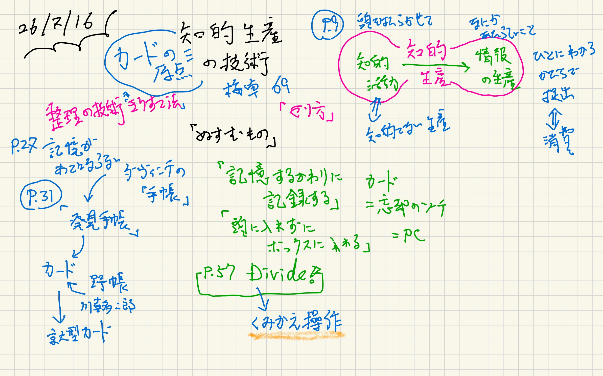
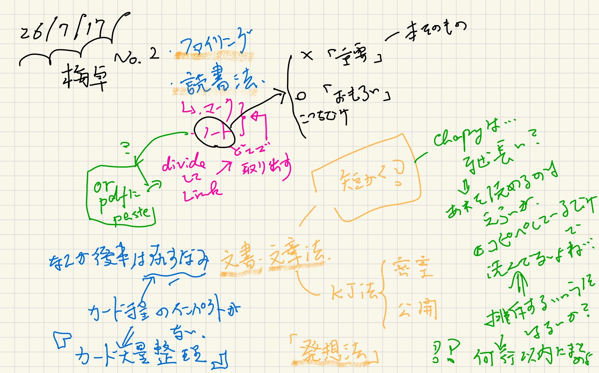

#+OPTIONS: ^:{}
#+STARTUP: indent nolineimages overview num
#+TITLE: 知的生産の技術
#+AUTHOR: Shigeto R. Nishitani
#+EMAIL:     (concat "shigeto_nishitani@mac.com")
#+LANGUAGE:  jp
#+OPTIONS:   H:4 toc:t num:2
#+HTML_HEAD: <link rel="stylesheet" type="text/css" href=".style_w_link_button.css" />
#+MACRO: dummy_link @@html:<a href="#">$1</a>@@

# for style.css, never move from here
[[../c3_linear_algebra_core/readme.html][prev_button]]
[[../intro_info_26s.html][up_button]]
[[../c1_outline/readme.html][next_button]]
# for a real link rewrite usual [[\url][]]

* intro
「知的生産の技術」梅棹忠夫のメモ．
- カード型の知識整理
  - 記憶する代わりに記録する
  - 頭に入れずにボックスに入れる
|  | 

* link
- [[https://kwanseio365-my.sharepoint.com/:b:/g/personal/cru32369_kwansei_ac_jp/IQDoW_-uTbiXTIgnA-nY5a7GASm4VFH1ey8MhLRIHQoNSFk?e=DQnCQO][Umesao69_知的生産の技術.pdf]]
