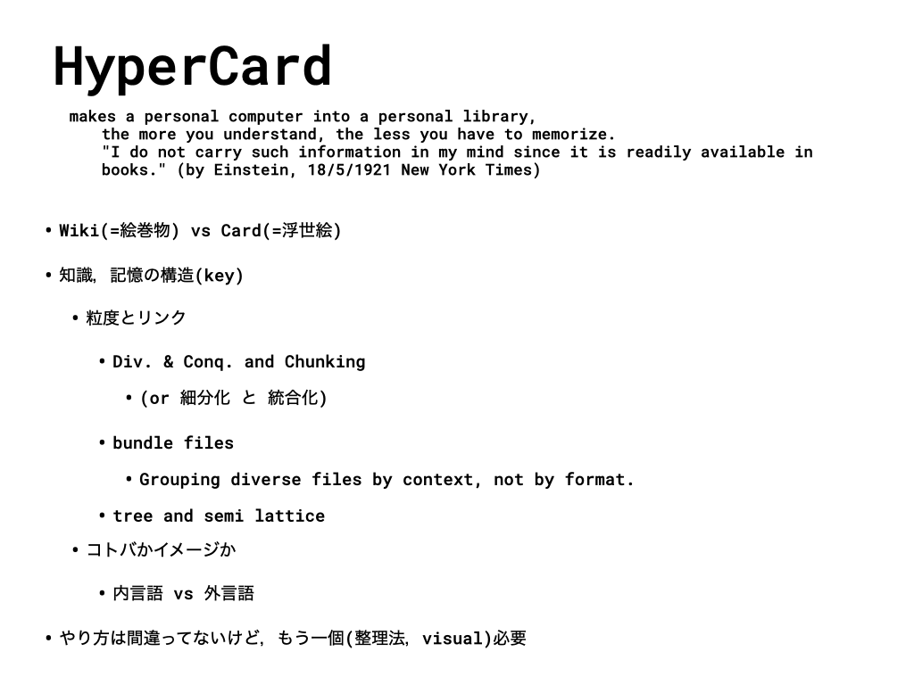
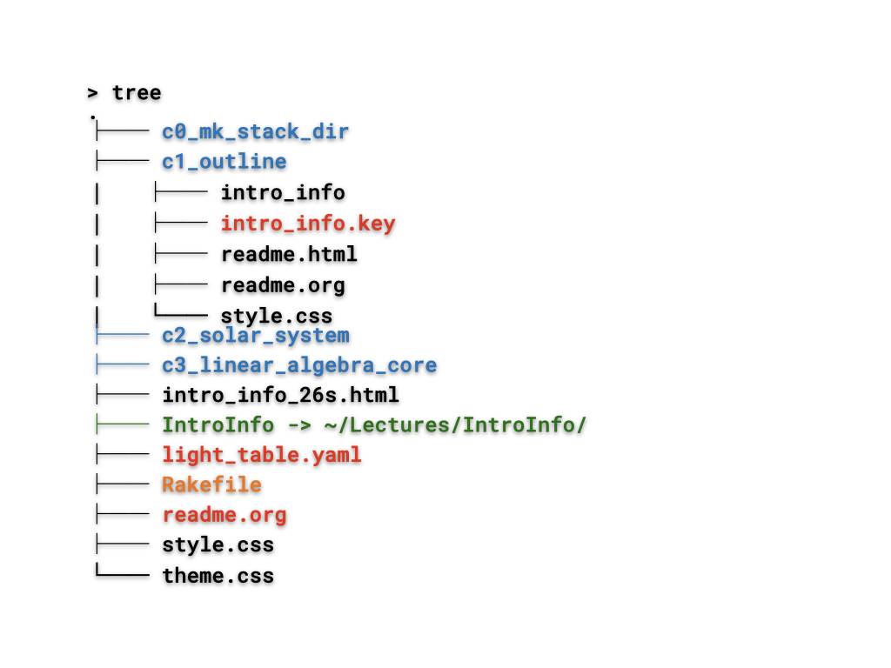
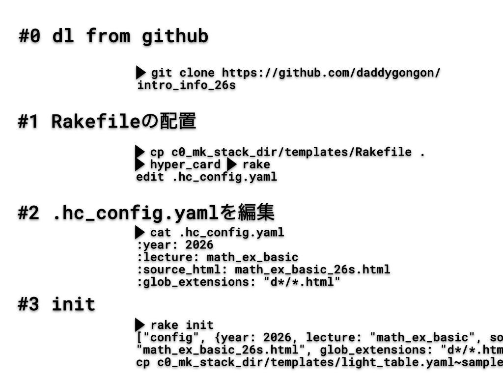
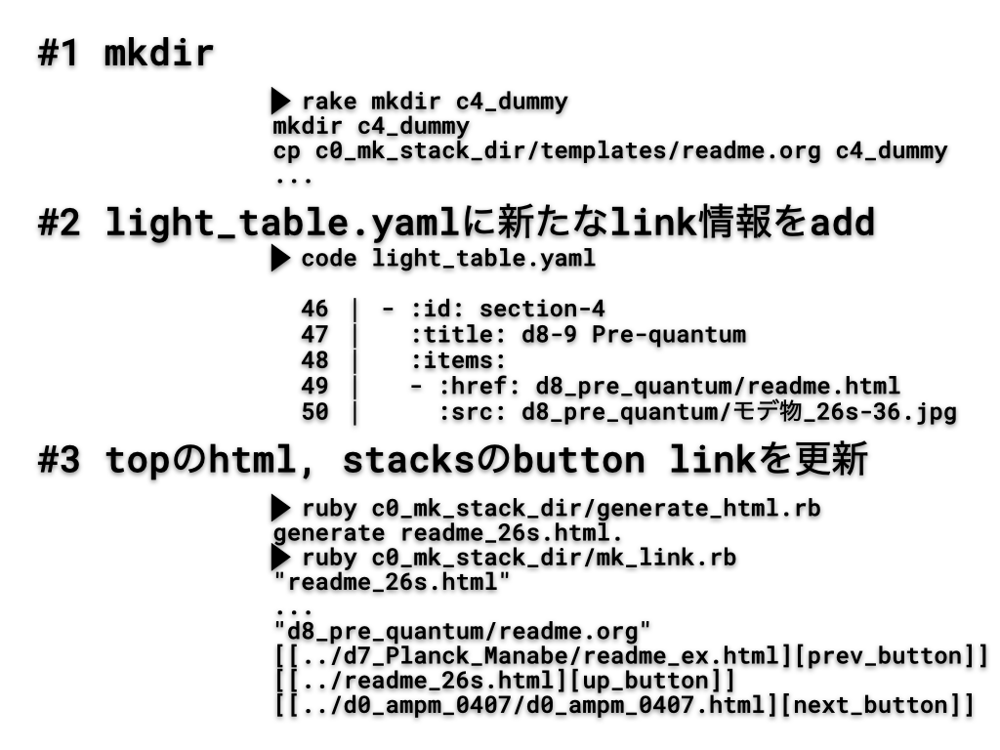

#+OPTIONS: ^:{}
#+STARTUP: indent nolineimages overview num
#+TITLE: mk_stack_dir
#+AUTHOR: Shigeto R. Nishitani
#+EMAIL:     (concat "shigeto_nishitani@mac.com")
#+LANGUAGE:  jp
#+OPTIONS:   H:4 toc:t num:2
#+HTML_HEAD: <link rel="stylesheet" type="text/css" href="style_w_link_button.css" />
#+MACRO: dummy_link @@html:<a href="#">$1</a>@@

# for style.css, never move from here
[[../c3_chunk/readme.html][prev_button]]
[[../pattern_language_26s.html][up_button]]
[[../c0_github/readme_by_emacs.html][next_button]]
# for a real link rewrite usual [[\url][]]

* name
Hyper Card Stacksの作成を補助するシステム
|  | 

* install
#+begin_src bash
> git clone https://github.com/daddygongon/intro_info_26s
#+end_src
* how to build html
|  |  | 

* link
- [[https://ist.ksc.kwansei.ac.jp/~nishitani/Lectures/2026/intro_info/c0_mk_stack_dir/c2_semi_lattice/readme.html][semi_lattice]]
