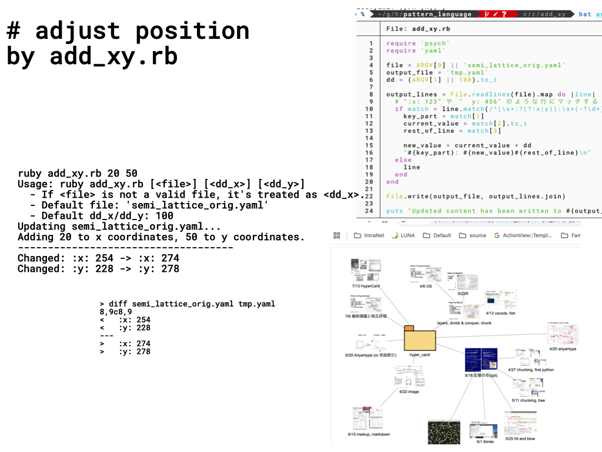

#+OPTIONS: ^:{}
#+STARTUP: indent nolineimages overview num
#+TITLE: c1 how to run
#+AUTHOR: Shigeto R. Nishitani
#+EMAIL:     (concat "shigeto_nishitani@mac.com")
#+LANGUAGE:  jp
#+OPTIONS:   H:4 toc:t num:2
#+SETUPFILE: https://fniessen.github.io/org-html-themes/org/setup/html-theme-readtheorg.setup
#+HTML_HEAD: <link rel="stylesheet" type="text/css" href=".style_w_link_button.css" />
#+MACRO: dummy_link @@html:<a href="#">$1</a>@@

# for style.css, never move from here
[[../c3_linear_algebra_core/readme.html][prev_button]]
[[../intro_info_26s.html][up_button]]
[[../c1_outline/readme.html][next_button]]
# for a real link rewrite usual [[\url][]]

* goal
| 

* style and theme
- color, font themeを
- https://morphos.ameyanagi.com/gallery?system=morphous-puffin
- Wildflower Meadow
- [[https://qiita.com/Ameyanagi/items/fd31a46683bba8bf55b7?utm_source=Qiita+%E3%83%8B%E3%83%A5%E3%83%BC%E3%82%B9&utm_campaign=763d4eac19-Qiita_newsletter_724_05_27_2026&utm_medium=email&utm_term=0_e44feaa081-763d4eac19-33455193&mc_cid=763d4eac19&mc_eid=335c4e5f7c][配色に悩む時間をゼロに。自然界モチーフのデザインシステム集「Morphos」を作りました]]
