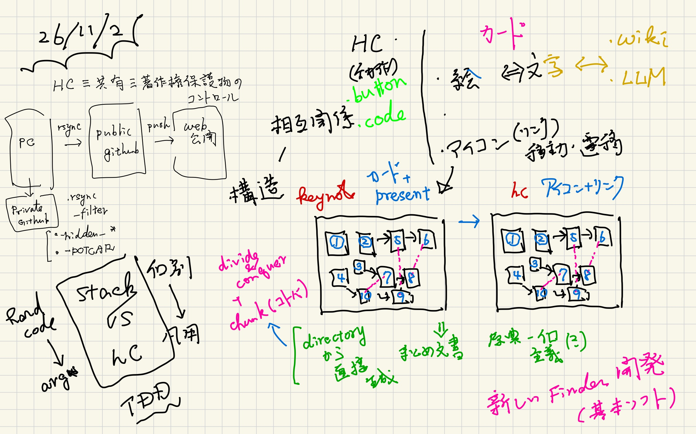

#+OPTIONS: ^:{}
#+STARTUP: indent nolineimages overview num
#+TITLE: HyperCard (vs (or) ~=) other systems
#+AUTHOR: Shigeto R. Nishitani
#+EMAIL:     (concat "shigeto_nishitani@mac.com")
#+LANGUAGE:  jp
#+OPTIONS:   H:4 toc:t num:2
#+SETUPFILE: https://fniessen.github.io/org-html-themes/org/setup/html-theme-readtheorg.setup
#+HTML_HEAD: <link rel="stylesheet" type="text/css" href=".style_for_image_content.css" />
#+MACRO: dummy_link @@html:<a href="#">$1</a>@@

# for style.css, never move from here
[[../c5_shingu/readme.html][prev_button]]
[[../readme.html][up_button]]
[[../c1_docs/readme.html][next_button]]
# for a real link rewrite usual [[\url][]]

| 

* HyperCardと他のsystem
『HyperCardって何』というのは，一言では難しくて，
他の既存システムと比べるとはっきりしてきます．

* HyperCard vs Wiki
知識の共有ということでは，WikiPediaがわかりやすいですよね．
これは典型的なHyperCardの派生物．
リンクでカードを遷移するいうのが，リンクの始まり．

でも，Wiki baseのシステムを使っていて，
「何度も同じ長い文章を繰って，読むのはいつも一箇所」
ってないですか？
LLMも文章が冗長になりガチです．
それは，知識レベルの違う万人に間違いなく伝えるため．
Wikiって巻物なんですよね．

それに対してHyperCardは浮世絵．
文字に対して絵で，
ブロマイドみたいに，
何度も見直して頭に焼き付ける対象．

* HyperCard ~= Keynote
HyperCardの発展形の一つがプレゼンソフト．
ここではKeynotoで紹介します．

Keynoteでプレゼンすると，当たり前だけど，一続きになりますよね．
でも，構想を錬るときはブロックで考えていません？
Preziという有料のプレゼンソフトがあって\cite{Prezi}，
これは遷移とか概略・詳細を視覚的に提供してくれます．
問題は，Preziの中でしかそういう機能が使えず，
共有が難しくなること．

Keynoteも少し工夫するとPrezi的なプレゼンが可能になります．
カードを書き出して，それを何かのソフトに貼り付けて動かす．
私はGoodNote上で手でやっていますが，
名工大の小林先生に
iPad純正のフリーボードには，
「特定の領域に順番にフォーカスする」機能があること
を教えてもらいました．
そうするとカード間の相互関係，つまり
包含，拡張，概要，詳細が視覚化できます．
それをWeb上で提供しようというのがHyperCardシステムのキモの一つ．
つまり，
- Keynote = Card + Presentation
- HyperCard = Icon + Link
という構図が成り立ちます．

* HyperCard ~= Directory 構造
HyperCardではお互いの相互関係を
#+begin_quote
Directory構造とFile拡張子とHiddenFiles
#+end_quote
の既約によって構築する事を目指しています．
そして，HyperCardのcanvas.htmlやまとめ文書の
自動生成を実現しようとしています．
実際は手で修正していますが．．．
でも雛形(templates)あるいは足場(scaffolds)は作れるので，
そんなのがあるのとないのとでは作業時間が大幅に違います．

つまりは，基本ソフトとなる
「新しいFinder」を構築・開発しているとも言えます．
我々は，気がつかない間に，MicrosoftとAppleの不毛な特許合戦で
少しいびつな物に慣らされてますので．．．

* HyperCard vs Stack
HyperCardシステムで作られる個別の知識のまとまりをStackと
名付けています．
書類が山積みになっているアイコンです．それに変えよう．
Stackを構築するのにRubyでcodeを作って，
Rakefile(MakefileのRuby版)で計算，ファイル操作の
機能を作っています．
個別の時には，directory/fileのpathを直接指定した
hard codeをしていて，
繰り返しのpatternが現れてくると汎化してHyperCardに
取り込むという流れでcodingを進めています．

これは，Kent Beckが提唱しているTDD\cite{Beck_TDD}を
Objectレベルよりも大きな
cla, systemレベルで実装する事を目論んでいます．
そういう開発手法も，HyperCardのStack交換の仕組みから
派生した開発法だと思っています．

* HyperCard vs Coding
実装してないのが，ButtonとCoding環境です．
HyperCardではButtonで色々な動作が表現されていました．
そしてHyperTalkという独自言語を
編集，デバッグする環境が内蔵されてました．

我々が開発しているHyperCardでは，
Terminal上のCLAとEditor(batcat)で代替させています．
そのレベルでいじるのはProgrammerだから，
馴染んだ環境/言語が良いんですよね．

* HyperCard ~= 著作物のコントロール
そして共有です．HyperCardのStack交換法として，
Floppy Diskで販売されていました．
Netの時代なので，GitHubとかが良さそうですが，
UserにとってはWebで直接見えて，操作できるのが良いですよね．
なのでHyperCardではURLへ登録する手順があります．
Web serverが動いていたら，Stack directoryごと
rsyncを掛けます．

この時問題になるのが著作物の制御．
これをHyperCardでは.rsync_filterという設定ファイルで行います．
一部を示すと
#+begin_src
> cat ../.rsync_filter
# バックアップ(emacs)や一時ファイルを除外
- *~

# OSの隠しファイルを除外
- .DS_Store
#- Thumbs.db

# 特定のディレクトリ（referencesディレクトリ）を除外
- references/
- gradings/
- hidden_*/
- .git/

# 特定の拡張子のファイル（key, pdfファイル）を除外
- POTCAR
#+end_src
です．Codexに聞くと，デフォルトで全pdfを除外して，
+で許可物を登録しろとなるのですが，
人が制御するには逆がいいと今ところ考えています．

最小のconfiguration設定を
公開制御(.rsync_filter)と公開設定(.hc_config.yaml)で行って
- rake rsync_public # public directoryへ
- rake push # web serverへ
で同期を行っています．
このorig_dir, pub_dir, push_dir三段構えは，
gitのアイデアから来ています．
元と中間状態が存在するので確認やrm -rfしてからのやり直しが容易です．
履歴なしでいつでもtidyな最新版にできます．

* References
- Prezi :: Prezi Inc., https://prezi.com/ (2026/11/2 accessed).
- Beck_TDD_j :: 「テスト駆動開発」, KentBeck, オーム社(2017).
- Beck_TDD_e :: “Test Driven Development by Example”, Kent Beck, Pearson Education Inc.(2003).
