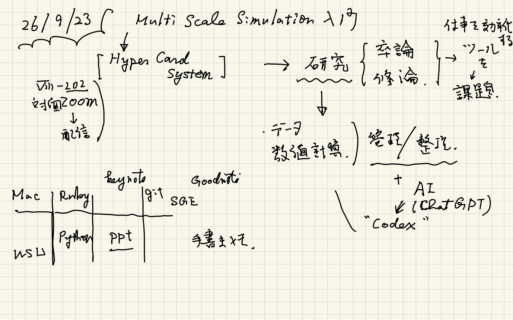
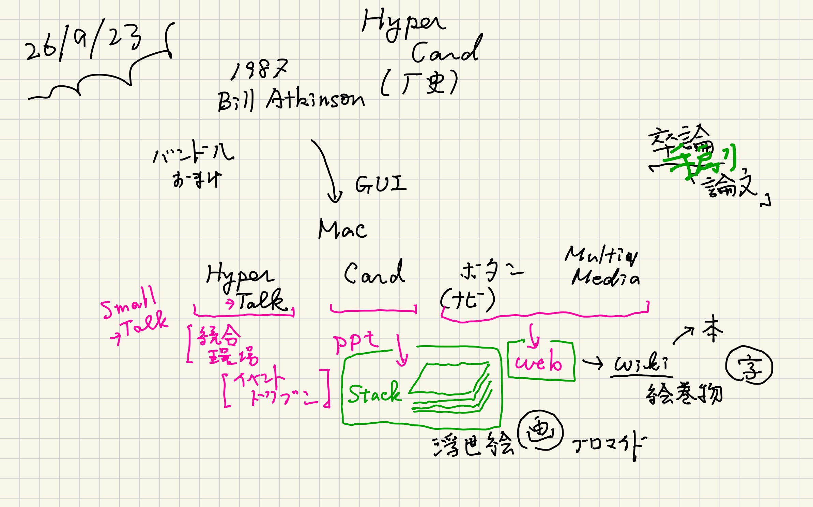
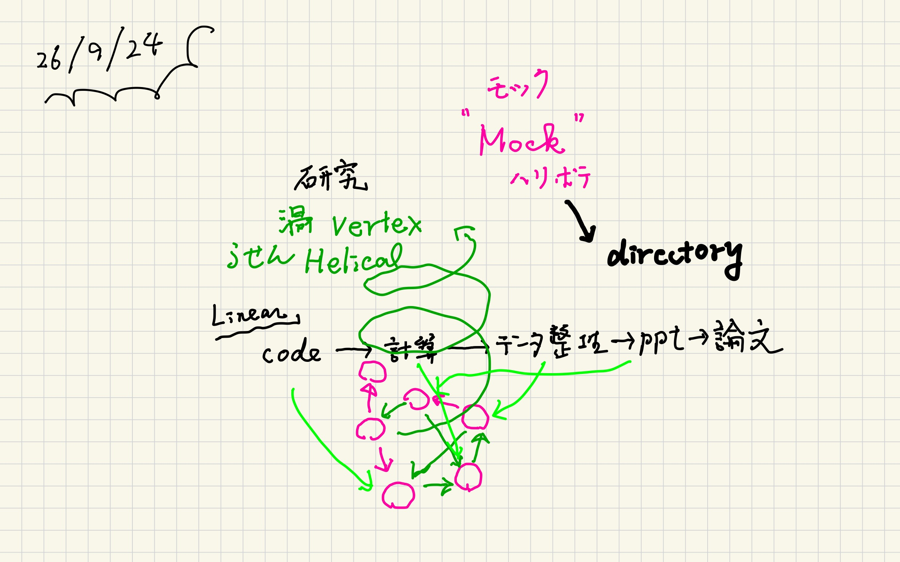
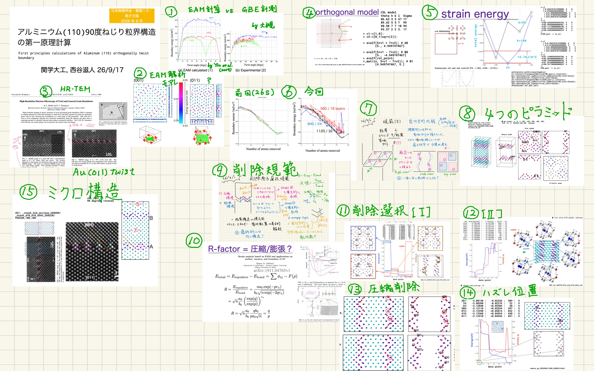
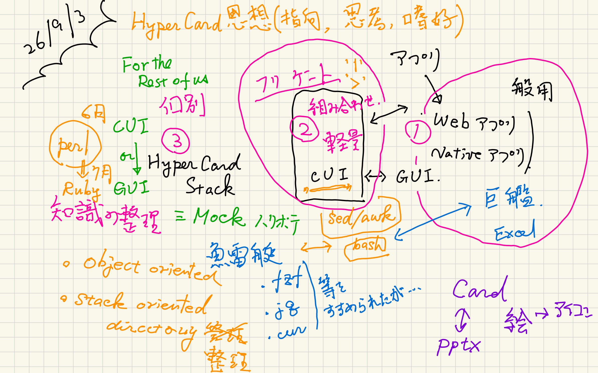
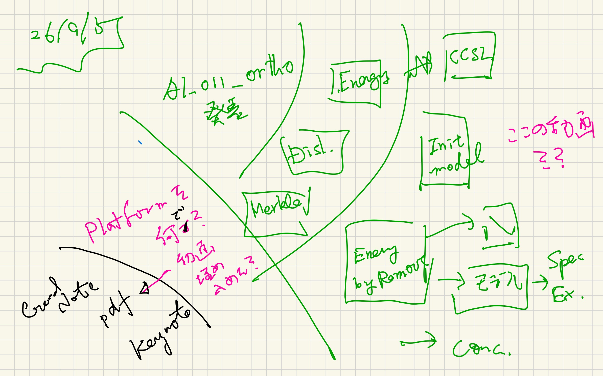
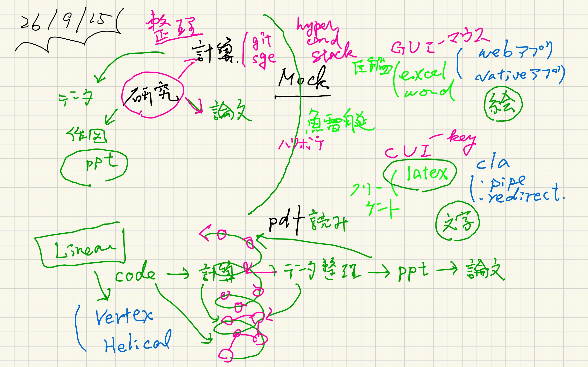

#+OPTIONS: ^:{}
#+STARTUP: indent nolineimages overview num
#+TITLE: d1 26/09/23 : Mock-Up (==Prototype)
#+AUTHOR: Shigeto R. Nishitani
#+EMAIL:     (concat "shigeto_nishitani@mac.com")
#+LANGUAGE:  jp
#+OPTIONS:   H:4 toc:t num:2
#+SETUPFILE: https://fniessen.github.io/org-html-themes/org/setup/html-theme-readtheorg.setup
#+HTML_HEAD: <link rel="stylesheet" type="text/css" href=".style_w_link_button.css" />
#+MACRO: dummy_link @@html:<a href="#">$1</a>@@

# for style.css, never move from here
[[../../d4-6_ruby/readme_junior.html][prev_button]]
[[../../canvas.html][up_button]]
[[../../d1-3_stack/d2_divide_chunk/readme.html][next_button]]
# for a real link rewrite usual [[\url][]]

* とっかかりはHyperCard
HyperCardっていう面白いソフトが初期のMacには無料でついてました．
これは，
#+begin_quote
an essential software construction kit 
that belonged in the hands of everday users
#+end_quote
とすることを目的としてBill Atkinsonによって1987年ごろに開発されました．
GUIアプリの基本は全て入っていたのですが，
その派生として登場するいくつものアプリ
(web browser, wiki, explorer, ppt, idea processor)
が，万人が使える仕様へ変貌する課程で，
多くのいいところが削がれていきました．
この授業では，院生，卒研生に利用してもらえる
Mock-Upを作りながら"HyperCard"のコンセプトを
理解してもらう予定です．

HyperCardはカードをまとめた"Stack"を
Floppy Diskに入れて交換(販売)してました．
まだInternetがなかったんですよ．
皆さんにはGithubを通してStackにアクセスしてもらいます．

|  | 
|  | [[file:./figs/on_line_jpgs/multi_scale_26f-4.jpg]]

* An example : jps_26f
| 

これは，9月に開かれた物理の学会発表のcardです．
このような最前線の研究でも使っている
Mock-Upを授業の後半で紹介するつもりです．

* Preparation notes
|  | [[file:./figs/prepare_jpgs/hyper_card_system-90.jpg]] | [[file:./figs/prepare_jpgs/hyper_card_system-91.jpg]]
| [[file:./figs/prepare_jpgs/hyper_card_system-92.jpg]] |  | 

