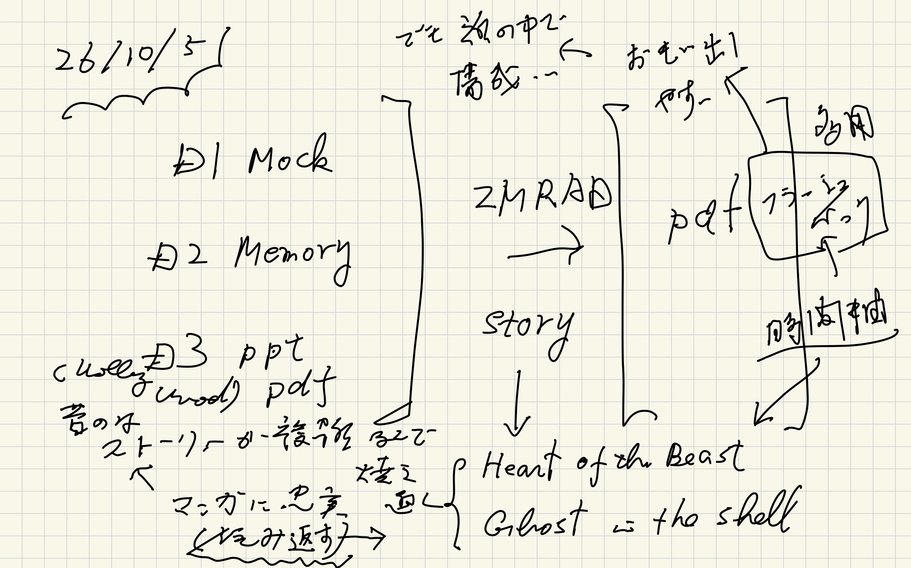
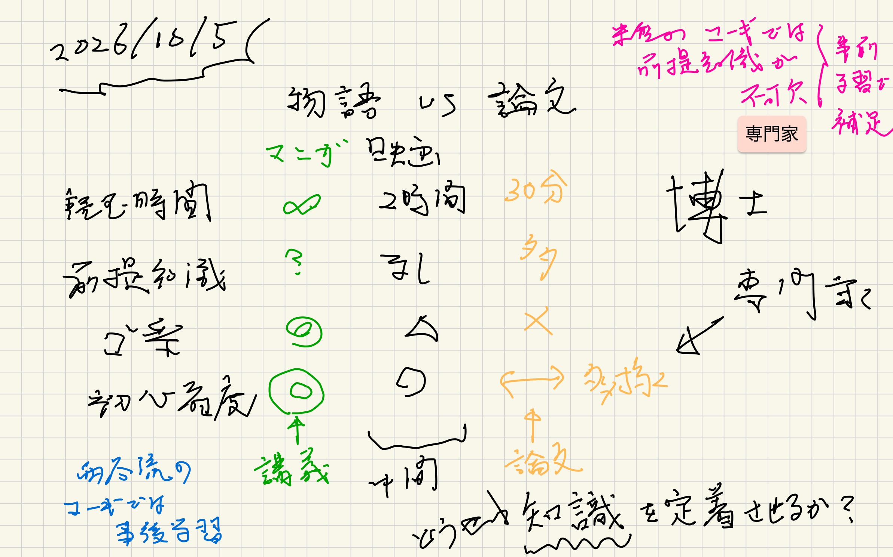
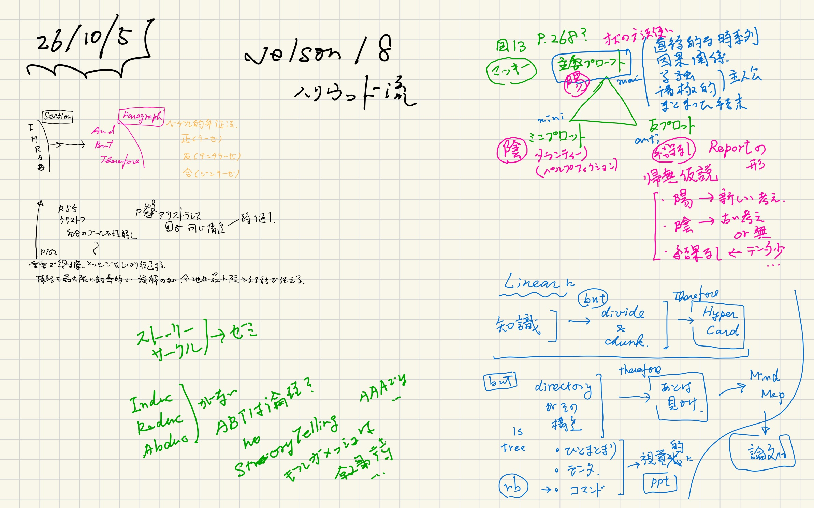
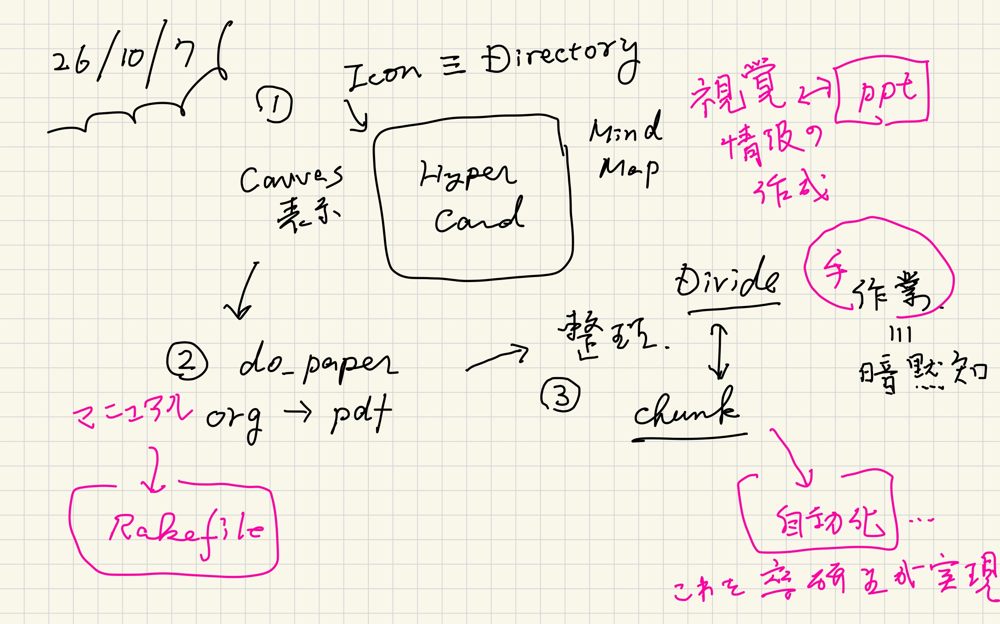
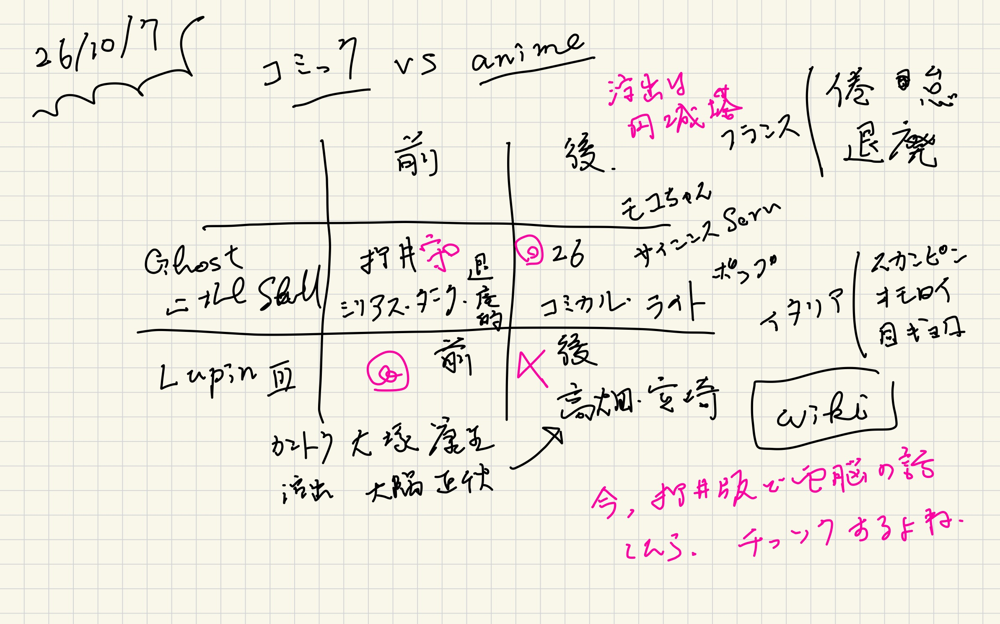
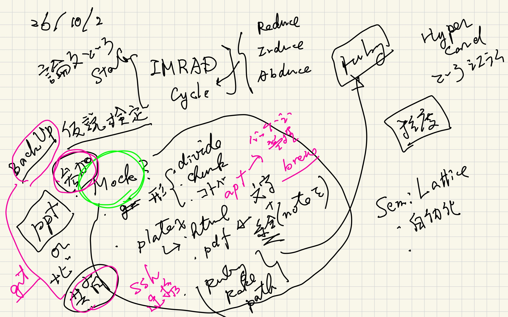
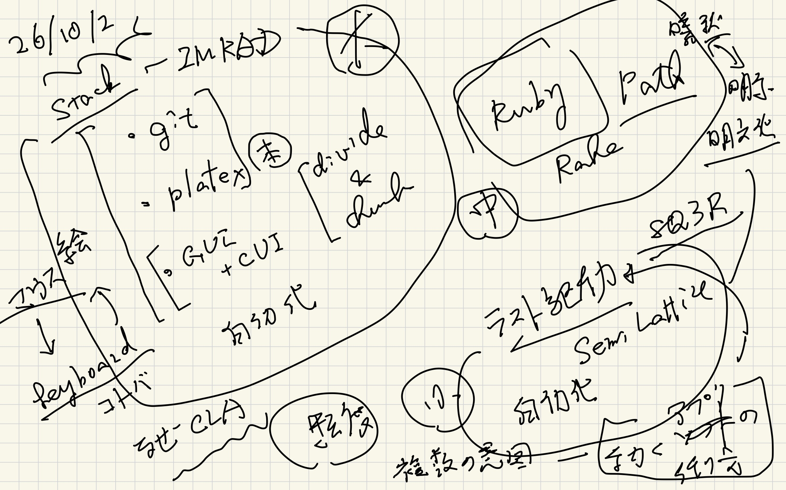
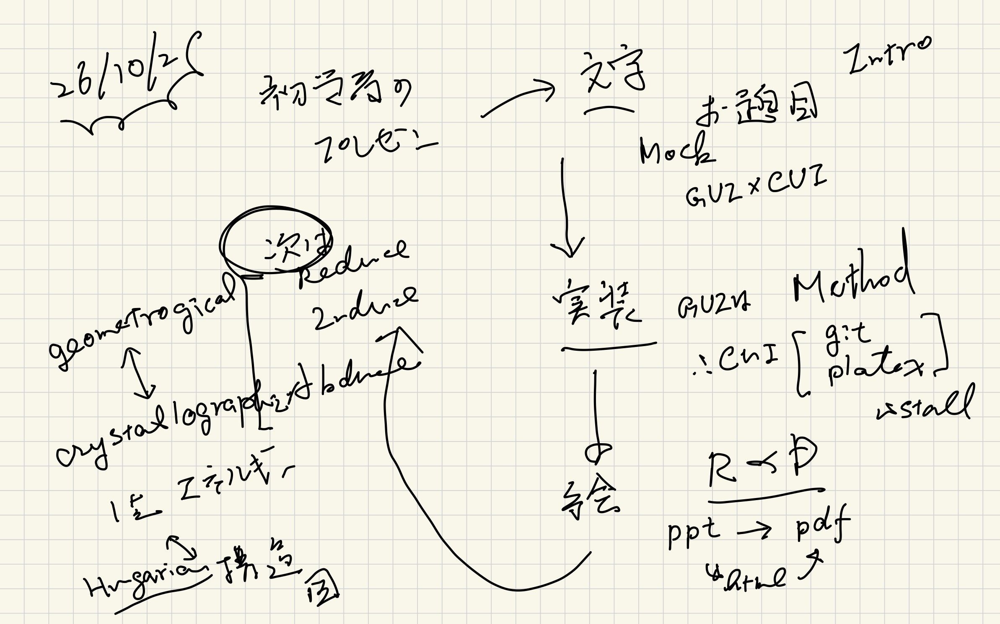

#+OPTIONS: ^:{}
#+STARTUP: indent nolineimages overview num
#+TITLE: Results and Discussions : ppt and pdf
#+AUTHOR: Shigeto R. Nishitani
#+EMAIL:     (concat "shigeto_nishitani@mac.com")
#+LANGUAGE:  jp
#+OPTIONS:   H:4 toc:t num:2
#+HTML_HEAD: <link rel="stylesheet" type="text/css" href=".style_w_link_button.css" />
#+MACRO: dummy_link @@html:<a href="#">$1</a>@@

# for style.css, never move from here
[[../../d1-3_stack/d2_divide_chunk/readme.html][prev_button]]
[[../../canvas.html][up_button]]
[[../../d99_junior_ruby/readme.html][next_button]]
# for a real link rewrite usual [[\url][]]

* mk ppt

HyperCardのMockが，
今見ていただいているcanva.htmlになります．

IconとかNaviとか，
ActionがGUIとCUIでどのように実現されているか
あるいはMockされているかを観察してください．

| [[file:./figs/mk_canvas.002.png]]
この時，こういったポンチ絵が役に立ちます．

* Pragmatic programmar (v2)
なぜCUIがGUIよりプログラマに良いのかは，
次のテキストを参照ください．

- basic tool
  - [[https://kwanseio365-my.sharepoint.com/:b:/g/personal/cru32369_kwansei_ac_jp/IQDjA5A55qKHR7k3ZFNjArzBAaHyx_EZhRW8-JSfW7i6vpA?e=BaQaLo][file:./hidden_files/p3_basic_tools.pdf]]
  - [[https://kwanseio365-my.sharepoint.com/:b:/g/personal/cru32369_kwansei_ac_jp/IQBDklNB41u8Qr_jZQ8WyFf_AYO_aCEre7NEfkW6531WEgw?e=8vseFE][file:./hidden_files/c16_plain_text.pdf]]
  - [[https://kwanseio365-my.sharepoint.com/:b:/g/personal/cru32369_kwansei_ac_jp/IQBgEsdsbyHLTr4LQO5Lj8hdAZYhjRbPyWF4iz_X2Q33B6o?e=aa8elg][file:./hidden_files/c17_shell.pdf]]
  - [[https://kwanseio365-my.sharepoint.com/:b:/g/personal/cru32369_kwansei_ac_jp/IQCbGkDz_NtGRaeVc9SYaseCAYhqCi_wpWNORQvAXp7CruU?e=rQF1tP][file:./hidden_files/c18_editor.pdf]]
  - [[https://kwanseio365-my.sharepoint.com/:b:/g/personal/cru32369_kwansei_ac_jp/IQDy2QskmGY1Qbwy9Vz_dSs5AXMtTTUTUZ2QA_VdLcp7KTU?e=4UtY6z][file:./hidden_files/c19_version_github.pdf]]
  - [[https://kwanseio365-my.sharepoint.com/:b:/g/personal/cru32369_kwansei_ac_jp/IQBmykqRCwoDQbOUjmz55PtkAYMGFzyg4iyi-WlQemPWysA?e=CfnPOl][file:./hidden_files/c22_note_my_help.pdf]]

* Why Ruby?
さて，では，これらがどうやって実現されているか？
そしてeverday usersの手によってどのように
構築されるかを示すのが次の目的になります．

以下のテキストにはその必要性が書かれています．

- [[https://kwanseio365-my.sharepoint.com/:b:/g/personal/cru32369_kwansei_ac_jp/IQCNOEYWPwBfQ5WdA_NASPPNAcO6ll2wSw7NOUbvHLTuriE?e=xCL24t][file:./hidden_files/c21_ruby.pdf]]
- [[https://kwanseio365-my.sharepoint.com/:b:/g/personal/cru32369_kwansei_ac_jp/IQAMCCml1Dw3RaWHRBuoTMQkAfSe9WOFwtXf5Ss3LrpJpzM?e=eojWsT][file:./hidden_files/c51_starter_kit_complete_auto.pdf]]

* Ghost?
- [[file:./rnn_vs_transform_ghost_gemini.html]]

* 準備メモ(preparation notes)

|  |  |
|  |  |
|  |                                    |

| [[file:./figs/multi_scale_26f-11.jpg]] | 
|  | 

