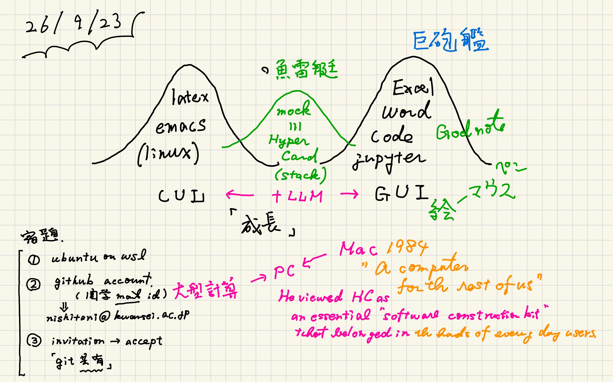
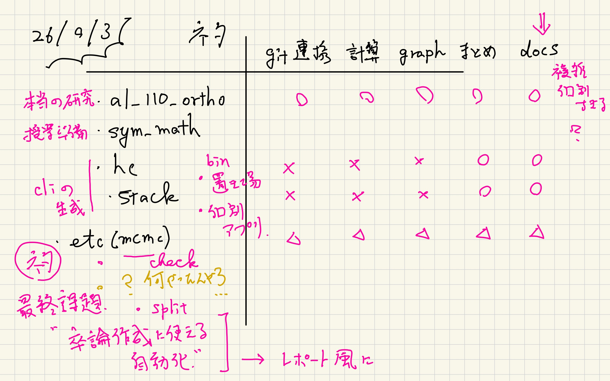
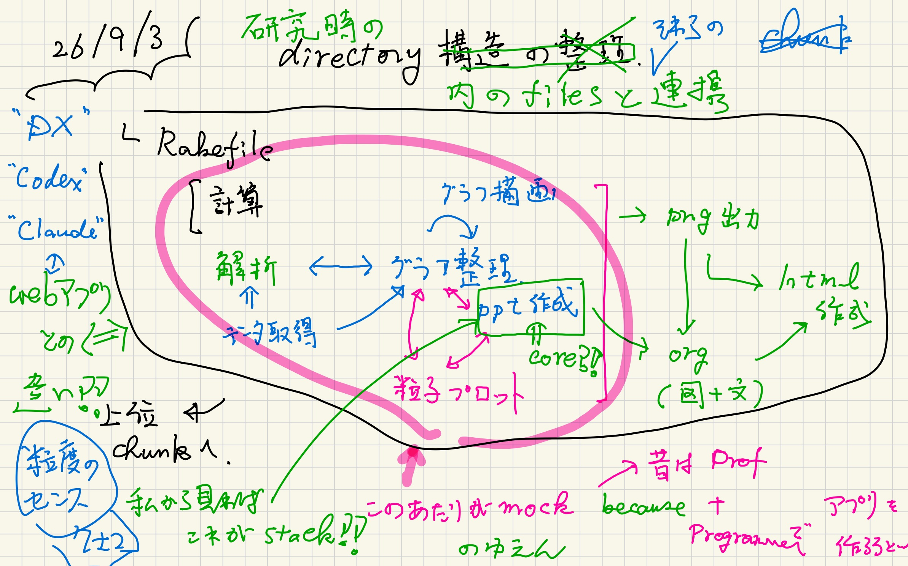
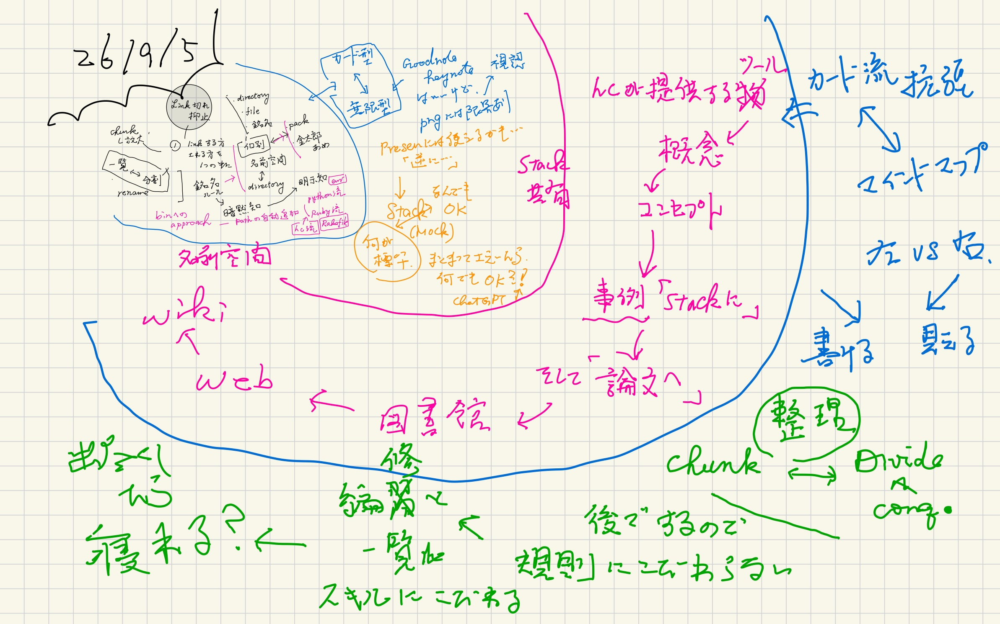

#+OPTIONS: ^:{}
#+STARTUP: indent nolineimages overview num
#+TITLE: Multi Scale Simulations
#+AUTHOR: Shigeto R. Nishitani
#+EMAIL:     (concat "shigeto_nishitani@mac.com")
#+LANGUAGE:  jp
#+OPTIONS:   H:4 toc:t num:2
#+HTML_HEAD: <link rel="stylesheet" type="text/css" href=".style_w_link_button.css" />
#+MACRO: dummy_link @@html:<a href="#">$1</a>@@

# for style.css, never move from here
[[../d99_junior_ruby/readme.html][prev_button]]
[[../multi_scale_26f.html][up_button]]
[[../d2_memory/readme.html][next_button]]
# for a real link rewrite usual [[\url][]]

* introduction
| [[file:./figs/on_line_jpgs/multi_scale_26f-1.jpg]] | [[file:./figs/on_line_jpgs/multi_scale_26f-2.jpg]]
| [[file:./figs/on_line_jpgs/multi_scale_26f-3.jpg]] | 

* An example : jps_26f
| [[file:figs/prepare_jpgs/hyper_card_system-94.jpg]]

* Preparation notes
| [[file:./figs/prepare_jpgs/hyper_card_system-89.jpg]] |  | 
|  | [[file:./figs/prepare_jpgs/hyper_card_system-93.jpg]] | [[file:./figs/prepare_jpgs/hyper_card_system-95.jpg]]

