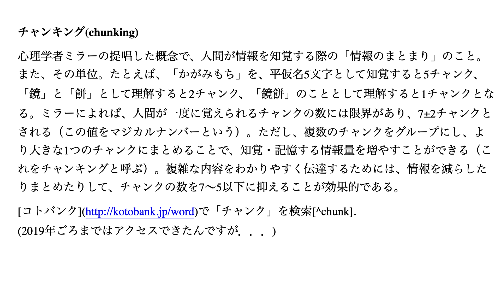
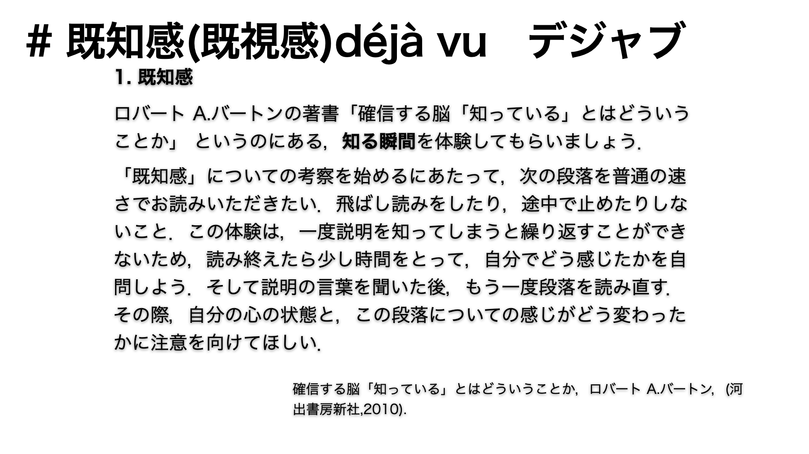
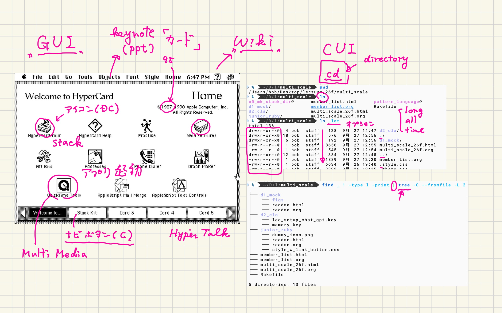
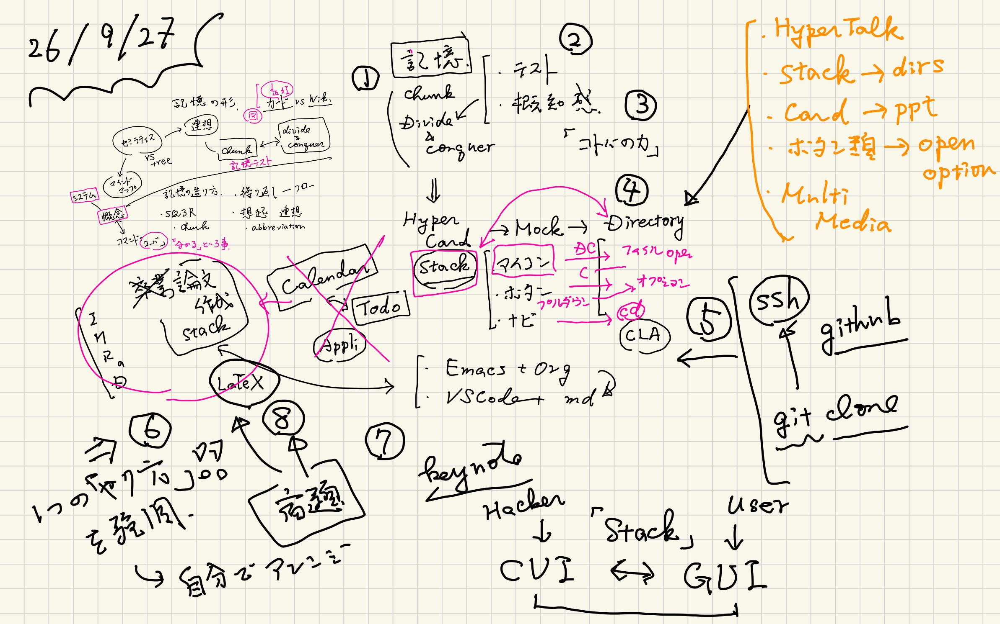
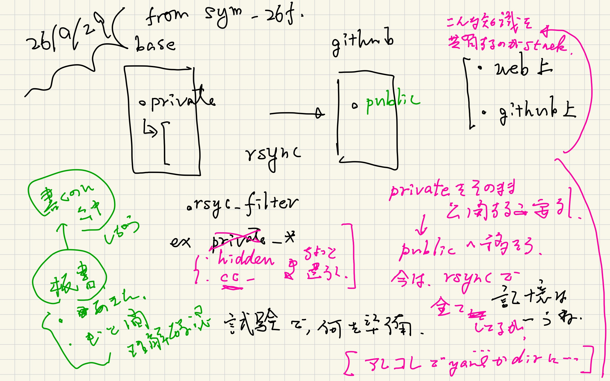

#+OPTIONS: ^:{}
#+STARTUP: indent nolineimages overview num
#+TITLE: Method : chunking, deja vu
#+AUTHOR: Shigeto R. Nishitani
#+EMAIL:     (concat "shigeto_nishitani@mac.com")
#+LANGUAGE:  jp
#+OPTIONS:   H:4 toc:t num:2
#+HTML_HEAD: <link rel="stylesheet" type="text/css" href=".style_w_link_button.css" />
#+MACRO: dummy_link @@html:<a href="#">$1</a>@@

# for style.css, never move from here
[[../d1_mock/readme.html][prev_button]]
[[../canvas.html][up_button]]
[[../d3_ppt_pdf/readme.html][next_button]]
# for a real link rewrite usual [[\url][]]

* chunking, dejavu, HyperCard
|  |  | 

知識構造の基本になる考え方が
chunkingとdeja vuです．
chunkingはまとまった知識を覚える人間の癖を
心理学者が解き明かした知恵です．
それをまとめる時には
deja vuで示したようにコトバで概念をまとめます．

これは卒業研究の本質に深く根ざしています．
それらの知識をまとめたのが次の文章です．
- [[./hyper_card_philosophy_w_gemini.org]]

* preparation notes
|   |   | 
