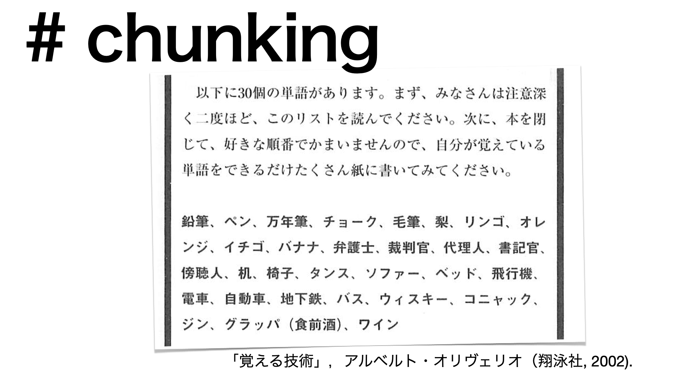
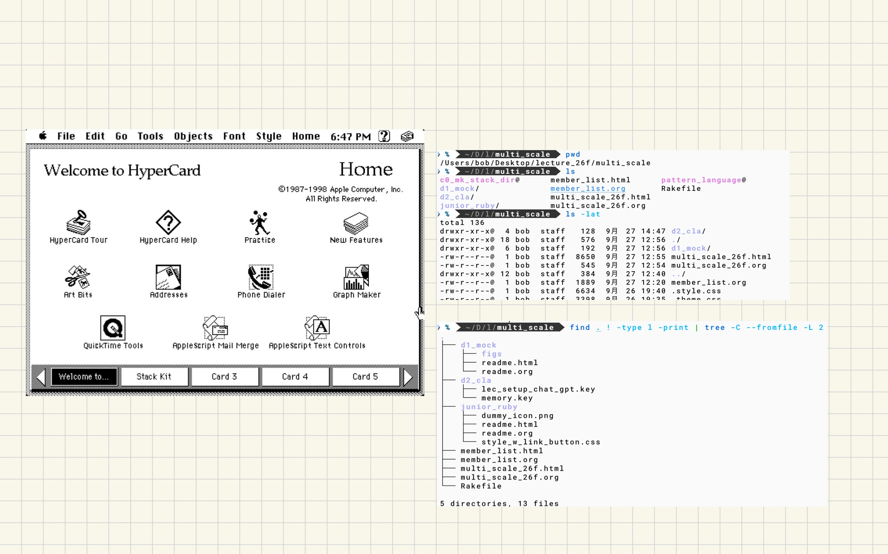

#+OPTIONS: ^:{}
#+STARTUP: indent nolineimages overview num
#+TITLE: mk_stack_dir
#+AUTHOR: Shigeto R. Nishitani
#+EMAIL:     (concat "shigeto_nishitani@mac.com")
#+LANGUAGE:  jp
#+OPTIONS:   H:4 toc:t num:2
#+HTML_HEAD: <link rel="stylesheet" type="text/css" href=".style_w_link_button.css" />
#+MACRO: dummy_link @@html:<a href="#">$1</a>@@

# for style.css, never move from here
[[../d1_mock/readme.html][prev_button]]
[[../multi_scale_26f.html][up_button]]
[[../d99_junior_ruby/readme.html][next_button]]
# for a real link rewrite usual [[\url][]]

* chunking
| 
* dejavu
| [[file:./figs/memory.005.png]]
* Hyper Card
| 

- [[./hyper_card_philosophy_w_gemini.org]]

