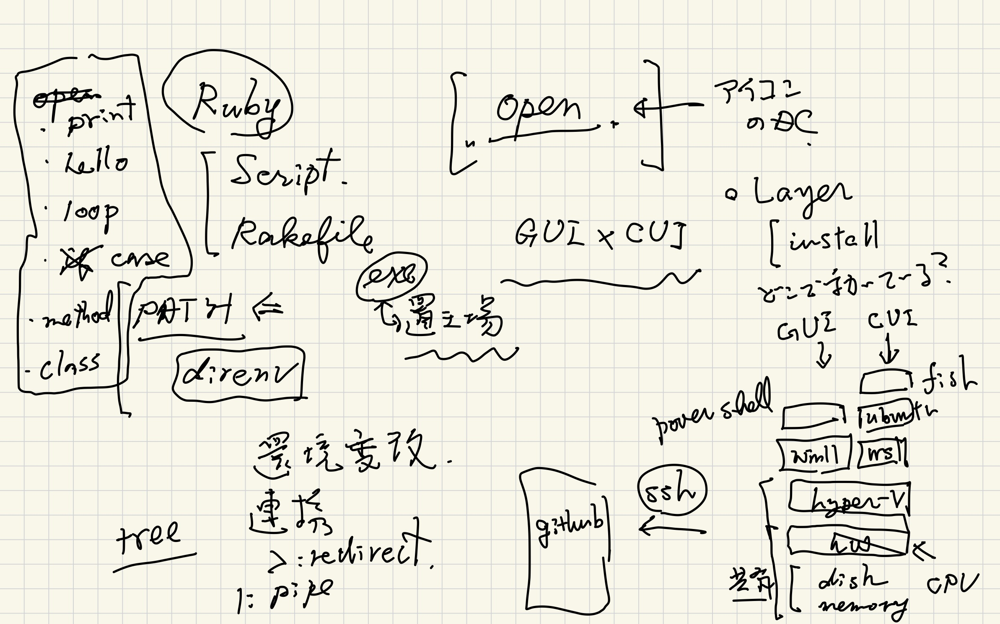

#+OPTIONS: ^:{}
#+STARTUP: indent nolineimages overview num
#+TITLE: semi lattice, IMRAD, make thesis
#+AUTHOR: Shigeto R. Nishitani
#+EMAIL:     (concat "shigeto_nishitani@mac.com")
#+LANGUAGE:  jp
#+OPTIONS:   H:4 toc:t num:2
#+HTML_HEAD: <link rel="stylesheet" type="text/css" href=".style_w_link_button.css" />
#+MACRO: dummy_link @@html:<a href="#">$1</a>@@

# for style.css, never move from here
[[../d2_memory/readme.html][prev_button]]
[[../multi_scale_26f.html][up_button]]
[[../d3_stack/hyper_card_philosophy_w_gemini.html][next_button]]
# for a real link rewrite usual [[\url][]]

|  | [[file:./figs/multi_scale_26f-12.jpg]]
| [[file:./figs/multi_scale_26f-13.jpg]] | [[file:./figs/multi_scale_26f-14.jpg]]

