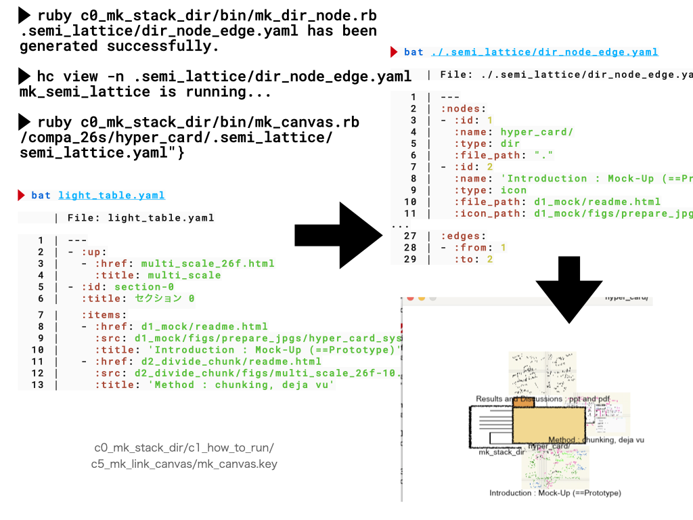

#+OPTIONS: ^:{}
#+STARTUP: indent nolineimages overview num
#+TITLE: Results and Discussions : ppt and pdf
#+AUTHOR: Shigeto R. Nishitani
#+EMAIL:     (concat "shigeto_nishitani@mac.com")
#+LANGUAGE:  jp
#+OPTIONS:   H:4 toc:t num:2
#+HTML_HEAD: <link rel="stylesheet" type="text/css" href=".style_w_link_button.css" />
#+MACRO: dummy_link @@html:<a href="#">$1</a>@@

# for style.css, never move from here
[[../d2_divide_chunk/readme.html][prev_button]]
[[../canvas.html][up_button]]
[[../d99_junior_ruby/readme.html][next_button]]
# for a real link rewrite usual [[\url][]]

* mk ppt

HyperCardのMockが，
今見ていただいているcanva.htmlになります．

IconとかNaviとか，
ActionがGUIとCUIでどのように実現されているか
あるいはMockされているかを観察してください．

| 

* Pragmatic programmar (v2)
なぜCUIがGUIよりプログラマに良いのかは，
次のテキストを参照ください．

- basic tool
  - p3_basic_tools.pdf
  - c16_plain_text.pdf
  - c17_shell.pdf
  - c18_editor.pdf
  - c19_version_github.pdf
  - c22_note_my_help.pdf

* Why Ruby?
さて，では，これらがどうやって実現されているか？
そしてeverday usersの手によってどのように
構築されるかを示すのが次の目的になります．

以下のテキストにはその必要性が書かれています．

- c21_ruby.pdf
- c51_starter_kit_complete_auto.pdf

* 準備メモ(preparation notes)
| [[file:./figs/multi_scale_26f-11.jpg]] | [[file:./figs/multi_scale_26f-12.jpg]]
| [[file:./figs/multi_scale_26f-13.jpg]] | [[file:./figs/multi_scale_26f-14.jpg]]

