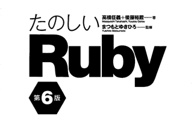
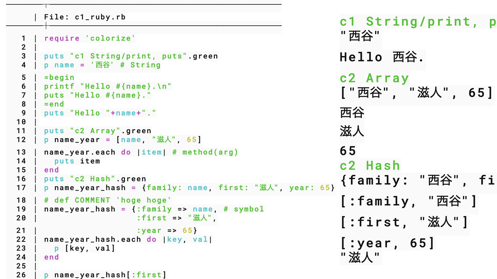
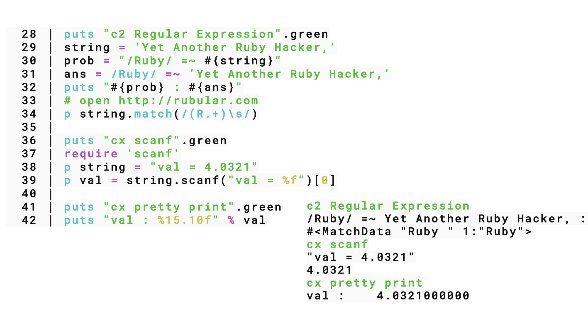

#+OPTIONS: ^:{}
#+STARTUP: indent nolineimages overview num
#+TITLE: Ruby basics
#+AUTHOR: Shigeto R. Nishitani
#+EMAIL:     (concat "shigeto_nishitani@mac.com")
#+LANGUAGE:  jp
#+OPTIONS:   H:4 toc:t num:3
#+SETUPFILE: https://fniessen.github.io/org-html-themes/org/setup/html-theme-readtheorg.setup
#+HTML_HEAD: <link rel="stylesheet" type="text/css" href=".style_w_link_button.css" />
#+MACRO: dummy_link @@html:<a href="#">$1</a>@@

# for style.css, never move from here
[[../../d1-3_stack/d3_ppt_pdf/readme.html][prev_button]]
[[../../canvas.html][up_button]]
[[../../d4-6_ruby/junior_seminar/readme_junior.html][next_button]]
# for a real link rewrite usual [[\url][]]

| 

* d5 <2026-10-21 Wed> command and direnv
** command line application
- TDD == 現場合わせ => 一般化，切り分け
- 現場合わせ
  - [[https://kwanseio365-my.sharepoint.com/:b:/g/personal/cru32369_kwansei_ac_jp/IQBmND61Ja45Q5mZsixYOVoAARY9aZCV3kDKYFhkA3V5R0M?e=QI2kbV][KentBeck Test Driven Development]]
  - object思考開発に設計はいらんという教え
- 実行コードの置き場(切り分け)
| ~path, '.', '~/bin', echo $PATH~  | for user whole       |
| ~direnv~                          | for object directory |
| ~Rakefile(next week?)~            | for dirs             |
| ~'.'~                             | for current dir      |
- memoの置き場
  - c1_ruby.rb => keynote => my_help
** misc cla on wsl
*** copy-as-org on fish on wsl
はい．Windows上のCodexアプリと，WSL内のFishを組み合わせても作れます．WindowsのクリップボードをWSLから読み取り，PandocでOrgへ変換し，再びWindowsのクリップボードへ戻します．

**** WSLへPandocをインストール
:PROPERTIES:
:CUSTOM_ID: 1wslへpandocをインストール
:END:
WSLのFishで実行します．

#+begin_src fish
sudo apt update
sudo apt install -y pandoc
#+end_src

確認します．

#+begin_src fish
pandoc --version
#+end_src

**** Fish関数を作成
:PROPERTIES:
:CUSTOM_ID: 2fish関数を作成
:END:
WSLのFishで次を実行します．

#+begin_src fish
function copy-as-org
    powershell.exe -NoProfile -Command 'Get-Clipboard -Raw' |
        pandoc -f gfm -t org |
        clip.exe
end
#+end_src

続けて保存します．

#+begin_src fish
funcsave copy-as-org
#+end_src

保存先はWSL内の次の場所です．

#+begin_src text
~/.config/fish/functions/copy-as-org.fish
#+end_src

一般的には次のようなパスになります．

#+begin_src text
/home/ユーザー名/.config/fish/functions/copy-as-org.fish
#+end_src

**** 登録確認
:PROPERTIES:
:CUSTOM_ID: 3登録確認
:END:
#+begin_src fish
type copy-as-org
functions --details copy-as-org
#+end_src

関数ファイルも確認できます．

#+begin_src fish
cat ~/.config/fish/functions/copy-as-org.fish
#+end_src

**** 使用方法
:PROPERTIES:
:CUSTOM_ID: 4使用方法
:END:
1. Windows版Codexで返信のコピーアイコンを押す．
2. Windows TerminalのWSL／Fishへ切り替える．
3. 次を実行する．

#+begin_src fish
copy-as-org
#+end_src

4. [@4] WindowsまたはWSL上のEmacsへ貼り付ける．

WindowsのクリップボードがOrg形式へ置き換わっているため，Windows側のアプリにも貼り付けられます．

Microsoft公式ドキュメントでも，WSLから =powershell.exe=
を実行でき，Linux側の出力を =clip.exe=
へ渡せることが説明されています．[[https://learn.microsoft.com/en-us/windows/dev-environment/wsl-interop][WSL相互運用]]．また，=Get-Clipboard -Raw=
は複数行のクリップボード内容を一つの文字列として取得します．[[https://learn.microsoft.com/en-us/powershell/module/microsoft.powershell.management/get-clipboard?view=powershell-5.1][Get-Clipboard]]．

**** 日本語が文字化けする場合
:PROPERTIES:
:CUSTOM_ID: 日本語が文字化けする場合
:END:
環境によってWindows
PowerShellの文字コードに差が出る可能性があります．その場合，PowerShell
7が入っていれば =powershell.exe= を =pwsh.exe= に変更します．

#+begin_src fish
function copy-as-org
    pwsh.exe -NoProfile -Command 'Get-Clipboard -Raw' |
        pandoc -f gfm -t org |
        clip.exe
end

funcsave copy-as-org
#+end_src

まずは =powershell.exe= 版を試し，日本語が崩れる場合だけ =pwsh.exe=
版へ切り替えるのがよいです．

*** direnv install
Fishなら，WSL内で次のように設定します．

#+begin_src fish
sudo apt update
sudo apt install -y direnv

mkdir -p ~/.config/fish
echo 'direnv hook fish | source' >> ~/.config/fish/config.fish

exec fish
#+end_src

確認します．

#+begin_src fish
direnv version

mkdir -p ~/direnv-test
cd ~/direnv-test
echo 'set -gx DIRENV_TEST ok' > .envrc
direnv allow
echo $DIRENV_TEST
#+end_src

~ok~ と表示されれば成功です．
Fish用のフックは，[[https://direnv.net/docs/hook.html][direnv公式設定手順]]でも
~direnv hook fish | source~ と指定されています．

* d6 <2026-10-28 Wed> Rakefile
- rake
- gems
* d4 <2026-10-14 Wed> Array Hash
** path
#+begin_src bash

> echo $PATH
> mkdir ~/bin
> cp multi_scale_public/bin/* ~/bin
> code ~/.config/fish/config.fish
> set PATH . ~/bin $PATH
#+end_src

** Ruby code
|  | 

** references
  - [[https://kwanseio365-my.sharepoint.com/:b:/g/personal/cru32369_kwansei_ac_jp/IQCCwCZq45rcTb4x2s0UW_GVAWf6TTj6jwKrKoPoXbi5ABw?e=92E0W4][c1_はじめてのRuby.pdf]]
  - [[https://kwanseio365-my.sharepoint.com/:b:/g/personal/cru32369_kwansei_ac_jp/IQC7L0rc33TEQZyzkjiCHWJMAQg9N_X3dixkptBq-__RFxk?e=G44QYp][c2_便利なオブジェクト.pdf]]
  - [[https://kwanseio365-my.sharepoint.com/:b:/g/personal/cru32369_kwansei_ac_jp/IQDi3DLsb-0MTL1KxhRNyzkYASuZ_Vl_V3jwNeEZhTTF4Wk?e=Wt0WAk][c3_コマンドを作ろう.pdf]]

