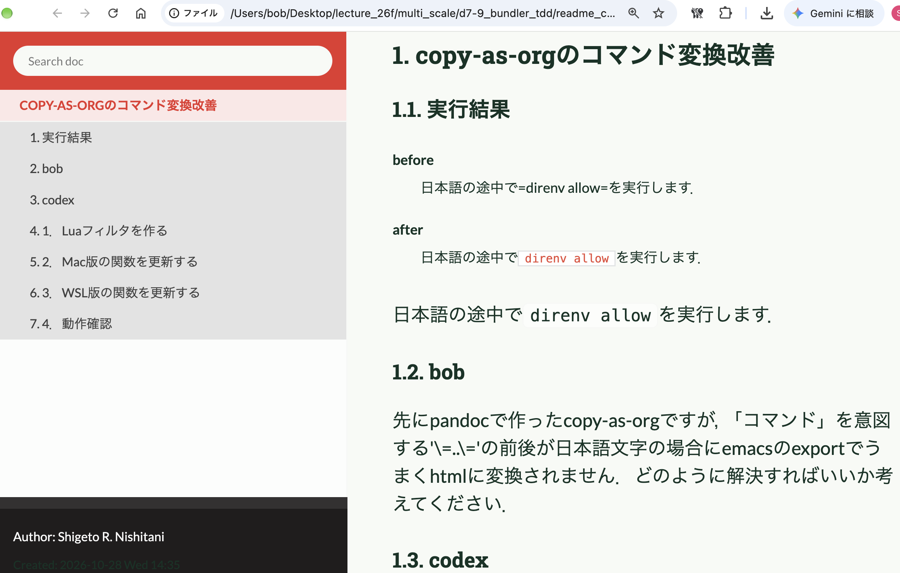

#+OPTIONS: ^:{}
#+STARTUP: indent nolineimages overview num
#+TITLE: chat for copy-as-org
#+AUTHOR: Shigeto R. Nishitani
#+EMAIL:     (concat "shigeto_nishitani@mac.com")
#+LANGUAGE:  jp
#+OPTIONS:   H:4 toc:t num:2
#+SETUPFILE: https://fniessen.github.io/org-html-themes/org/setup/html-theme-readtheorg.setup
#+HTML_HEAD: <link rel="stylesheet" type="text/css" href=".style_w_link_button.css" />
#+MACRO: dummy_link @@html:<a href="#">$1</a>@@

# for style.css, never move from here
[[file:../readme_rag_agent.html][prev_button]]
[[file:../canvas.html][up_button]]
[[file:../d7_bundle/readme.html][next_button]]
# for a real link rewrite usual [[\url][]]

| 

* copy-as-orgのコマンド変換改善
** 実行結果
- before :: 日本語の途中で=direnv allow=を実行します．
- after :: 日本語の途中で​=direnv allow=​を実行します．

日本語の途中で​=direnv allow=​を実行します．

** bob
先にpandocで作ったcopy-as-orgですが，「コマンド」を意図する'\=..\='の前後が日本語文字の場合にemacsのexportでうまくhtmlに変換されません．どのように解決すればいいか考えてください．
** codex

原因は，Org-modeのインラインコード記法に「前後の文字」に関する条件があるためです．

PandocはMarkdownの

#+begin_src markdown
日本語`command`です
#+end_src

を次のように変換します．

#+begin_src org
日本語=command=です
#+end_src

しかし，Org-modeは日本語文字と直接隣接した ​==command==​
をインラインコードとして認識しません．​=~command~=​
に変更しても同じ問題が起きます．

最も単純な解決方法は空白を入れることです．

#+begin_src org
日本語 =command= です
#+end_src

ただし，日本語として余分な空白が見えてしまいます．そこで，PandocのLuaフィルタを使い，見えないゼロ幅スペースをインラインコードの前後へ挿入する方法が適しています．実際にEmacsのHTML
exporterで検証し，正しく ​=<code>command</code>=​
へ変換されることを確認しました．

** 1．Luaフィルタを作る
:PROPERTIES:
:CUSTOM_ID: 1luaフィルタを作る
:END:
Fishで保存用ディレクトリを作ります．MacでもWSLでも同じです．

#+begin_src fish
mkdir -p ~/.config/pandoc/filters
#+end_src

Emacsで次のファイルを開きます．

#+begin_src fish
emacs ~/.config/pandoc/filters/org-inline-code.lua
#+end_src

次の内容を保存してください．

#+begin_src lua
local zwsp = utf8.char(0x200B)

function Code(element)
  if FORMAT:match("org") then
    return pandoc.RawInline(
      "org",
      zwsp .. "=" .. element.text .. "=" .. zwsp
    )
  end
end
#+end_src

このフィルタは，Markdownとして解析されたインラインコードだけを対象にします．ソースコードブロック内の
​===​ や通常の文章には触れません．

** 2．Mac版の関数を更新する
:PROPERTIES:
:CUSTOM_ID: 2mac版の関数を更新する
:END:
Fishで関数を再定義します．

#+begin_src fish
function copy-as-org
    pbpaste |
        pandoc -f gfm -t org \
            --lua-filter="$HOME/.config/pandoc/filters/org-inline-code.lua" |
        pbcopy
end
#+end_src

保存します．

#+begin_src fish
funcsave copy-as-org
#+end_src

** 3．WSL版の関数を更新する
:PROPERTIES:
:CUSTOM_ID: 3wsl版の関数を更新する
:END:
WindowsのクリップボードをWSLから扱う場合はこちらです．

#+begin_src fish
function copy-as-org
    powershell.exe -NoProfile -Command 'Get-Clipboard -Raw' |
        pandoc -f gfm -t org \
            --lua-filter="$HOME/.config/pandoc/filters/org-inline-code.lua" |
        clip.exe
end
#+end_src

保存します．

#+begin_src fish
funcsave copy-as-org
#+end_src

** 4．動作確認
:PROPERTIES:
:CUSTOM_ID: 4動作確認
:END:
Codexから，例えば次のような文章をコピーします．

#+begin_src markdown
日本語の途中で`direnv allow`を実行します．
#+end_src

コピー後に実行します．

#+begin_src fish
copy-as-org
#+end_src

Orgバッファへ貼り付けると，見た目は概ね次のようになります．

#+begin_src org
日本語の途中で​=direnv allow=​を実行します．
#+end_src

​===​
の外側にはU+200Bのゼロ幅スペースが入っていますが，画面上やHTML上では空白として見えません．OrgからHTMLへexportすると，

#+begin_src html
日本語の途中で​<code>direnv allow</code>​を実行します．
#+end_src

となります．

この方式なら，Org側の設定を変更する必要がなく，生成したOrgファイルを別のEmacs環境へ移しても正しくexportできます．また，単純な正規表現置換と異なり，ソースコードブロックを誤って書き換える危険もありません．

