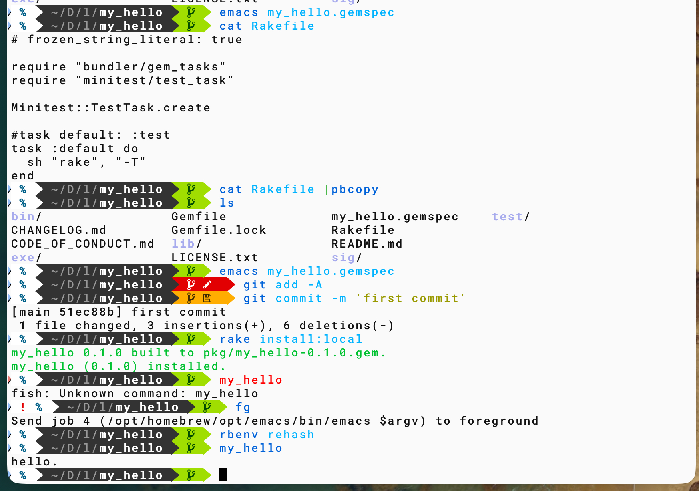

#+OPTIONS: ^:{}
#+STARTUP: indent nolineimages overview num
#+TITLE: d7 1104 bundle
#+AUTHOR: Shigeto R. Nishitani
#+EMAIL:     (concat "shigeto_nishitani@mac.com")
#+LANGUAGE:  jp
#+OPTIONS:   H:4 toc:t num:2
#+SETUPFILE: https://fniessen.github.io/org-html-themes/org/setup/html-theme-readtheorg.setup
#+HTML_HEAD: <link rel="stylesheet" type="text/css" href=".style_w_link_button.css" />
#+MACRO: dummy_link @@html:<a href="#">$1</a>@@

# for style.css, never move from here
[[../../junior_seminar/readme_junior.html][prev_button]]
[[../../canvas.html][up_button]]
[[../../d1-3_stack/d1_mock/readme.html][next_button]]
# for a real link rewrite usual [[\url][]]

| 

* bundle
: gem install bundler
: bundle gem my_hello --exe --test=minitest

: env BUNDLE_IGNORE_CONFIG=1 bundle gem my_hello --exe
#+begin_src zsh
Creating gem 'my_hello'...

Do you want to generate tests with your gem?
Future `bundle gem` calls will use your choice. This setting can be changed anytime with `bundle config gem.test`.
Enter a test framework. rspec/minitest/test-unit/(none): minitest
Enter a CI service. github/gitlab/circle/(none): github
Do you want to include a code of conduct in gems you generate? y/(n): y
Do you want to include a changelog? y/(n): y
Enter a linter. rubocop/standard/(none): none

Initializing git repo in /Users/bob/Desktop/lecture_26f/my_hello
      create  my_hello/Gemfile
      create  my_hello/lib/my_hello.rb
      create  my_hello/lib/my_hello/version.rb
      create  my_hello/sig/my_hello.rbs
      create  my_hello/my_hello.gemspec
      create  my_hello/Rakefile
      create  my_hello/README.md
      create  my_hello/bin/console
      create  my_hello/bin/setup
      create  my_hello/.gitignore
      create  my_hello/test/test_helper.rb
      create  my_hello/test/test_my_hello.rb
      create  my_hello/.github/workflows/main.yml
      create  my_hello/LICENSE.txt
      create  my_hello/CODE_OF_CONDUCT.md
      create  my_hello/CHANGELOG.md
      create  my_hello/exe/my_hello

Gem 'my_hello' was successfully created. For more information on making a RubyGem visit https://guides.rubygems.org/make-your-own-gem/
#+end_src

> bundle exec exe/my_hello

* edit lib/my_hello.rb
puts "hello."
> bundle exec exe/my_hello
* rake install:local
#+begin_src ruby
# Rakefile
# frozen_string_literal: true

require "bundler/gem_tasks"
require "minitest/test_task"

Minitest::TestTask.create

#task default: :test
task :default do
  sh "rake", "-T"
end
#+end_src

: edit my_help.gemspec # TODO => ???
: git add -A
: git commit -m 'first commit'
: rake install:local
: rbenv rehash

* for wsl
apt版Rubyではrbenvのshimがないため，​=rbenv rehash=​に相当する操作は不要です．RubyGemsが作成した実行ファイルが​=PATH=​上にあるかどうかだけで決まります．

一般ユーザーでインストールする場合，gemはユーザーディレクトリへ入ります．実行ファイルは通常，次のどちらかです．

#+begin_src text
~/.local/share/gem/ruby/<ABIバージョン>/bin
~/.gem/ruby/<ABIバージョン>/bin
#+end_src

正確な場所は次で確認できます．

#+begin_src shell
ruby -e 'puts Gem.user_dir'
#+end_src

実行ファイルがあるか確認します．

#+begin_src shell
ls "$(ruby -e 'puts Gem.user_dir')/bin/my_hello"
#+end_src

この​=bin=​は通常​=PATH=​に入っていないため，bashを使うWSLでは​=~/.bashrc=​へ追加します．

#+begin_src shell
echo 'export PATH="$(ruby -e '\''puts Gem.user_dir'\'')/bin:$PATH"' >> ~/.bashrc
source ~/.bashrc
#+end_src

その後は直接実行できます．

#+begin_src shell
my_hello
#+end_src

ユーザー領域へ明示的にインストールする場合は，次の手順が確実です．

#+begin_src shell
rake build
gem install --user-install pkg/my_hello-0.1.0.gem
#+end_src

一方，​=sudo gem install=​や​=sudo rake install:local=​ではsystem領域へ入り，実行ファイルは通常​=/usr/local/bin=​などへ作成されます．ここは最初から​=PATH=​に入っているため，インストール直後から実行できます．ただし，apt管理のRubyと手動インストールしたgemが混在するため，RubyGems公式は​=sudo gem install=​より​=--user-install=​を推奨しています．[[https://guides.rubygems.org/gem-installation-and-loading/][RubyGems公式ガイド]]

つまり，apt版Rubyでの違いは次のとおりです．

- rbenv版：実行ファイルをインストール後，shim生成のため​=rbenv rehash=​が必要になる場合がある．
- apt版のsystem install：​=PATH=​上へwrapperが作られれば即座に実行できる．
- apt版のuser
  install：rehashは不要だが，​=Gem.user_dir/bin=​を​=PATH=​へ追加する必要がある．

