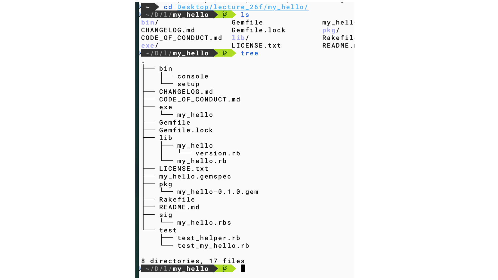

#+OPTIONS: ^:{}
#+STARTUP: indent nolineimages overview num
#+TITLE: TDD
#+AUTHOR: Shigeto R. Nishitani
#+EMAIL:     (concat "shigeto_nishitani@mac.com")
#+LANGUAGE:  jp
#+OPTIONS:   H:4 toc:t num:2
#+SETUPFILE: https://fniessen.github.io/org-html-themes/org/setup/html-theme-readtheorg.setup
#+HTML_HEAD: <link rel="stylesheet" type="text/css" href=".style_w_link_button.css" />
#+HTML_HEAD: 
#+MACRO: dummy_link @@html:<a href="#">$1</a>@@

# for style.css, never move from here
[[../c3_linear_algebra_core/readme.html][prev_button]]
[[../intro_info_26s.html][up_button]]
[[../c1_outline/readme.html][next_button]]
# for a real link rewrite usual [[\url][]]

* sub_orgs
- [[file:./readme_mk_stack_directory_conf.org][授業段取りのアイデア]]
- [[file:./readme_my_hello_tdd_live.org][授業でのライブcode]]
- [[file:./readme_save_chat_to_org.org][save-chat-to-orgの作成依頼]]

| 

* scaffold(足場)
- gem my_hello --exe --test=minitest
- defaultで作るmy_helloは.git管理されているが，
  multi_scaleの.gitとconflictするので，
  .gitを削除している

* introとして
- testの書き方とagent 仕様書md化の一致
  - [[https://qiita.com/kodai_kitahara/items/d9b8c30d50e7bc8be317][生成AIに渡す仕様書はどう書くべきか]]
    - AIが「読みやすい」形式と「読みにくい」形式

* for the 2nd day
- Kent BeckのTDDをRubyに直すのはちょっと遠すぎる感じ．
- Gem directoryでのminitestの動作を実演
- hcへの移植を示すべき
