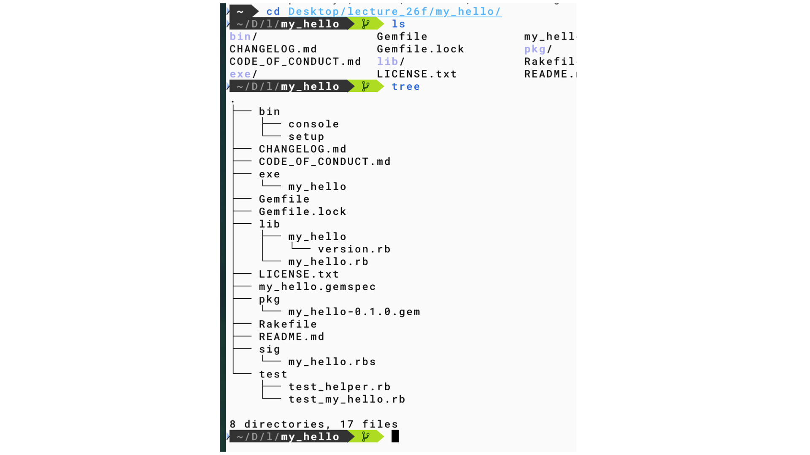

#+OPTIONS: ^:{}
#+STARTUP: indent nolineimages overview num
#+TITLE: d8 my_hello Live coding with Codex
#+AUTHOR: Shigeto R. Nishitani
#+EMAIL:     (concat "shigeto_nishitani@mac.com")
#+LANGUAGE:  jp
#+OPTIONS:   H:4 toc:t num:2
#+SETUPFILE: https://fniessen.github.io/org-html-themes/org/setup/html-theme-readtheorg.setup
#+HTML_HEAD: <link rel="stylesheet" type="text/css" href=".style_w_link_button.css" />
#+MACRO: dummy_link @@html:<a href="#">$1</a>@@

# for style.css, never move from here
[[file:./readme_mkstack_dir_conf.html][prev_button]]
[[file:../canvas.html][up_button]]
[[file:./readme_save_chat_to_org.html][next_button]]
# for a real link rewrite usual [[url][]]

| 

* Turn 1 : Hello出力のテストを追加
** user => Bob
multi_scale/d7-9_bundler_tdd/d8_tdd/my_helloを作成しました．
Helloがちゃんと返っているかをtestするのを，test/test_my_hello.rbに追記してください．

** codex => Raphael
[[/Users/bob/Desktop/lecture_26f/multi_scale/d7-9_bundler_tdd/d8_tdd/my_hello/test/test_my_hello.rb][test/test_my_hello.rb]]
に，​=Hello.=​ の標準出力を確認するテストを追加しました．

テスト結果：3件すべて成功，エラーなしです．

* Turn 2 : Minitestのカラー表示を相談
** user => Bob
green とかredを実感するために，minitestをcolorfulにするlibはありますか？

** codex => Raphael
あります．おすすめは ​=minitest-reporters=​
です．成功を緑，失敗を赤で表示でき，テスト名も見やすくなります．

​=Gemfile=​ に追加します．

#+begin_src ruby
gem "minitest-reporters", group: :test
#+end_src

インストールします．

#+begin_src console
bundle install
#+end_src

​=test/test_helper.rb=​ の末尾に追加します．

#+begin_src ruby
require "minitest/reporters"

Minitest::Reporters.use!(
  Minitest::Reporters::DefaultReporter.new(color: true)
)
#+end_src

実行はこれまでどおりです．

#+begin_src console
bundle exec rake test
#+end_src

もっと簡単な選択肢として，赤・緑表示に特化した ​=minitest-rg=​
もあります．ただ，表示形式を後から変更できるため，授業用には
[[https://github.com/minitest-reporters/minitest-reporters][​=minitest-reporters=​]]
が使いやすいと思います．[[https://github.com/minitest/minitest-rg][​=minitest-rg=​]]
は，より小さく単純な選択肢です．

* Turn 3 : gemspecへの依存追記を提示
** user => Bob
gemspecに追記するtextを表示してください．

** codex => Raphael
​=my_hello.gemspec=​ の ​=Gem::Specification.new=​ ブロック内に追記します．

#+begin_src ruby
spec.add_development_dependency "minitest-reporters"
#+end_src

既存の ​=minitest=​
依存関係の近くに置くと分かりやすいです．追記後は次を実行します．

#+begin_src console
bundle install
#+end_src

* Turn 4 : greetingのNameErrorを診断
** user => Bob
#+begin_src text
 bundle exec exe/my_hello
bundler: failed to load command: exe/my_hello (exe/my_hello)
/Users/bob/Desktop/lecture_26f/multi_scale/d7-9_bundler_tdd/d8_tdd/my_hello/lib/my_hello.rb:12:in '<module:MyHello>': undefined local variable or method 'greeting' for module MyHello (NameError)

  greeting
  ^^^^^^^^
#+end_src

とのエラーが出ます．なぜ？

** codex => Raphael
原因は，次の ​=def greeting=​ が ​=MyHello=​
モジュールのインスタンスメソッドとして定義されるためです．

#+begin_src ruby
module MyHello
  def greeting
    puts "Hello."
  end

  greeting # MyHello自身にはこのメソッドがない
end
#+end_src

​=MyHello.greeting=​
として使えるモジュールメソッドにするには，次の形が分かりやすいです．

​=lib/my_hello.rb=​：

#+begin_src ruby
module MyHello
  class Error < StandardError; end

  def self.greeting
    puts "Hello."
  end
end
#+end_src

​=exe/my_hello=​：

#+begin_src ruby
#!/usr/bin/env ruby

require "my_hello"

MyHello.greeting
#+end_src

テストも，ファイルの再読み込みではなくメソッドを直接検証できます．

#+begin_src ruby
def test_it_outputs_hello
  assert_output("Hello.\n") do
    MyHello.greeting
  end
end
#+end_src

この構成なら，​=require "my_hello"=​
しただけでは表示されず，​=MyHello.greeting=​ を呼んだときだけ ​=Hello.=​
が表示されます．

* Turn 5 : greetingをモジュールメソッドへ修正
** user => Bob
では，そのように修正ください．

** codex => Raphael
修正しました．

- ​=greeting=​ を ​=MyHello.greeting=​ として定義
- ​=exe/my_hello=​ から明示的に呼び出すよう変更
- テストも ​=MyHello.greeting=​ を直接検証する形へ変更

確認結果：

#+begin_src text
3 tests, 3 assertions, 0 failures, 0 errors
#+end_src

実行結果：

#+begin_src text
Hello.
#+end_src

* Turn 6 : 名前付き挨拶へ変更
** user => Bob
bundle exec exe/my_hello bob とした時に， Hello, bob.
と返るようにlibとtestを修正してください．

** codex => Raphael
修正しました．

#+begin_src console
bundle exec exe/my_hello bob
#+end_src

実行結果：

#+begin_src text
Hello, bob.
#+end_src

テストも成功しています．

#+begin_src text
3 tests, 3 assertions, 0 failures, 0 errors
#+end_src

* Turn 7 : Greetingオブジェクトのテストを追加
** user => Bob
今作ったgreeting関数をobjectにしたとして，そのテストをtest/test_my_hello.rbに作ってください．

** codex => Raphael
​=test/test_my_hello.rb=​ に，次のテストを追加しました．

#+begin_src ruby
def test_greeting_object_outputs_hello_with_name
  greeting = MyHello::Greeting.new("bob")

  assert_output("Hello, bob.\n") do
    greeting.call
  end
end
#+end_src

現在は ​=MyHello::Greeting=​ が未実装なので，意図どおり RED になります．

#+begin_src text
NameError: uninitialized constant MyHello::Greeting
4 tests, 3 assertions, 0 failures, 1 errors
#+end_src

想定する使い方は次の形です．

#+begin_src ruby
greeting = MyHello::Greeting.new("bob")
greeting.call
#+end_src

* Turn 8 : Greetingオブジェクトを実装
** user => Bob
MyHello::Greetingをlib/my_hello.rbに作成してください．

** codex => Raphael
​=lib/my_hello.rb=​ に ​=MyHello::Greeting=​ を実装しました．

#+begin_src ruby
class Greeting
  def initialize(name)
    @name = name
  end

  def call
    puts "Hello, #{@name}."
  end
end
#+end_src

既存の ​=MyHello.greeting=​ も，このオブジェクトへ処理を委譲します．

テスト結果：

#+begin_src text
4 tests, 4 assertions, 0 failures, 0 errors
#+end_src

実行結果：

#+begin_src text
Hello, bob.
#+end_src

* Turn 9 : ThorでCLIオプションを解析
** user => Bob
libraryのthorを使って，command
optionをparseするようにlib/my_help.rbを変更してください．

** codex => Raphael
Thor を使ってコマンドオプションを解析するように変更しました．

実行方法：

#+begin_src console
bundle exec exe/my_hello greeting --name bob
#+end_src

短縮オプションも利用できます．

#+begin_src console
bundle exec exe/my_hello greeting -n bob
#+end_src

出力：

#+begin_src text
Hello, bob.
#+end_src

あわせて以下も変更しました．

- ​=lib/my_hello.rb=​ に ​=MyHello::CLI < Thor=​ を追加
- ​=exe/my_hello=​ から ​=MyHello::CLI.start(ARGV)=​ を実行
- gemspec に ​=thor=​ の通常依存を追加
- CLIのオプション解析テストを追加
- ​=Gemfile.lock=​ を更新

テスト結果は ​=5 tests, 5 assertions, 0 failures, 0 errors=​ です．

* Turn 10 : Thor CLIのテストを拡充
** user => Bob
では，このthorのテストを作ってください．

** codex => Raphael
Thor CLI用のテストを ​=TestMyHelloCLI=​ クラスとして追加しました．

検証内容は次の3点です．

- ​=--name bob=​ を解析できる
- 短縮形の ​=-n bob=​ を解析できる
- ​=--name=​ が未指定の場合にエラーを表示する

テスト結果：

#+begin_src text
7 tests, 8 assertions, 0 failures, 0 errors
#+end_src

* Turn 11 : チャットをOrgファイルへ保存
** user => Bob
save-chat-to-orgしてください．

** codex => Raphael
このチャット全体を ​=readme_chat.org=​
に保存し，ターン順序，話者ペア，Org見出し構造を検証しました．
