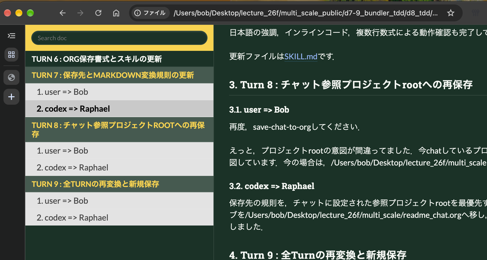
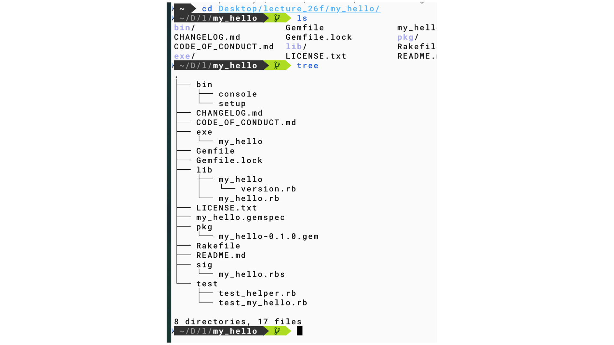

#+OPTIONS: ^:{}
#+STARTUP: indent nolineimages overview num
#+TITLE:  Org保存書式とスキルの更新
#+AUTHOR: Shigeto R. Nishitani
#+EMAIL:     (concat "shigeto_nishitani@mac.com")
#+LANGUAGE:  jp
#+OPTIONS:   H:4 toc:t num:2
#+SETUPFILE: https://fniessen.github.io/org-html-themes/org/setup/html-theme-readtheorg.setup
#+HTML_HEAD: <link rel="stylesheet" type="text/css" href=".style_w_link_button.css" />
#+MACRO: dummy_link @@html:<a href="#">$1</a>@@

# for style.css, never move from here
[[file:./readme_my_hello_tdd_live.html][prev_button]]
[[file:../canvas.html][up_button]]
[[file:../d9_gem_release/readme.html][next_button]]
# for a real link rewrite usual [[url][]]

| 

* Turn 6 : Org保存書式とスキルの更新
** user => Bob
このchatをorgに保存してください．少しスキルを修正してください．生成するorgファイルのhead部分を

#+begin_example
#+OPTIONS: ^:{}
#+STARTUP: indent nolineimages overview num
#+TITLE: d7-9 bundle, thor, minitest
#+AUTHOR: Shigeto R. Nishitani
#+EMAIL:     (concat "shigeto_nishitani@mac.com")
#+LANGUAGE:  jp
#+OPTIONS:   H:4 toc:t num:2
#+SETUPFILE: https://fniessen.github.io/org-html-themes/org/setup/html-theme-readtheorg.setup
#+HTML_HEAD: <link rel="stylesheet" type="text/css" href=".style_w_link_button.css" />
#+MACRO: dummy_link @@html:<a href="#">$1</a>@@

# for style.css, never move from here
[[../c3_linear_algebra_core/readme.html][prev_button]]
[[../intro_info_26s.html][up_button]]
[[../c1_outline/readme.html][next_button]]
# for a real link rewrite usual [[url][]]

| 
#+end_example

としてください．それとturn毎のheadを

#+begin_example
 \* Turn 1 : one line note
 \** user => Bob
 \** codex => Raphael
#+end_example

と変更してください．
** codex => Raphael
​=save-chat-to-org=​スキルを，指定された固定ヘッダーと話者見出しを使うよう更新しました．このチャット全体を新しい書式で​=readme_chat.org=​へ保存し，Turn番号，話者の組，Org見出し構造を検証しました．

* Turn 7 : 保存先とMarkdown変換規則の更新
** user => Bob
save-chat-to-orgスキルの修正です．

1. readme_chat.orgの保存先のデフォルトを依頼したプロジェクトのroot_directoryにしましょう．
2. copy-as-orgというfishコマンドを以前にRaphaelさんと作っています．そこで，md=>org変換に，微妙な修正(-...-にした時の全角文字の前後への空白挿入，数式？)を加えています．それを参照して本文も変換できますか？
** codex => Raphael
​=save-chat-to-org=​スキルを修正しました．

- デフォルト保存先を，依頼対象プロジェクトのroot directoryに変更
- 明示されたworkspace rootを優先
- 不明な場合は​=git rev-parse --show-toplevel=​で判定
- ​=copy-as-org=​の定義を毎回確認し，クリップボード処理を除くPandoc変換を本文へ適用
- 日本語に隣接するOrg装飾へゼロ幅スペースを挿入
- display数式内の改行を空白へ変換
- Turn見出し，話者見出し，固定ヘッダーはPandoc変換の対象外

日本語の強調，インラインコード，複数行数式による動作確認も完了しています．

更新ファイルは[[/Users/bob/.codex/skills/save-chat-to-org/SKILL.md][SKILL.md]]です．

* Turn 8 : チャット参照プロジェクトrootへの再保存
** user => Bob
再度，save-chat-to-orgしてください．

えっと，プロジェクトrootの意図が間違ってました．今chatしているプロジェクトの参照directoryのrootを意図しています．今の場合は，/Users/bob/Desktop/lecture_26f/multi_scale です．
** codex => Raphael
保存先の規則を，チャットに設定された参照プロジェクトrootを最優先するよう修正しました．既存アーカイブを/Users/bob/Desktop/lecture_26f/multi_scale/readme_chat.orgへ移し，未保存だったTurn 7とTurn 8を追記しました．

* Turn 9 : 全Turnの再変換と新規保存
** user => Bob
ごめんなさい．Turn 7,8を新たに追記するのではなく，新たにsave-chat-to-orgしてください．Turn 6までにある​=...=​もhtml変換したときに残っているのが気になるので．
** codex => Raphael
差分追記ではなく，現在の全9 Turnをcopy-as-orgの最新規則で再変換し，参照プロジェクトrootのreadme_chat.orgとして再構築しました．日本語に隣接するインラインコードにはゼロ幅スペースが入り，OrgのHTML変換で​=...=​が文字として残らないことを確認しました．
