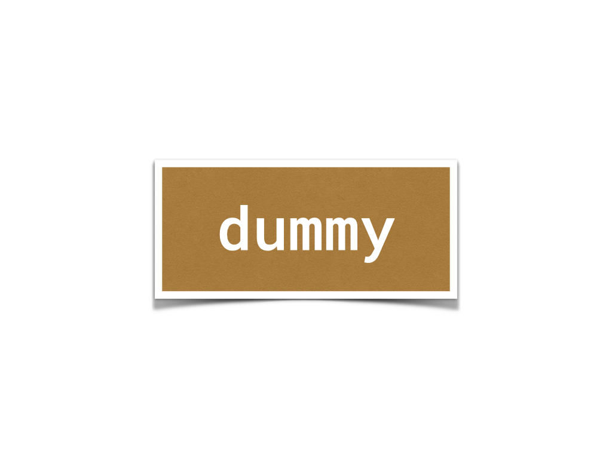

#+OPTIONS: ^:{}
#+STARTUP: indent nolineimages overview num
#+TITLE: d9 gem release
#+AUTHOR: Shigeto R. Nishitani
#+EMAIL:     (concat "shigeto_nishitani@mac.com")
#+LANGUAGE:  jp
#+OPTIONS:   H:4 toc:t num:2
#+SETUPFILE: https://fniessen.github.io/org-html-themes/org/setup/html-theme-readtheorg.setup
#+HTML_HEAD: <link rel="stylesheet" type="text/css" href=".style_w_link_button.css" />
#+MACRO: dummy_link @@html:<a href="#">$1</a>@@

# for style.css, never move from here
[[file:../d8_tdd/readme_save_chat_to_org.html][prev_button]]
[[file:../canvas.html][up_button]]
[[file:../readme.html][next_button]]
# for a real link rewrite usual [[\url][]]

# | 

