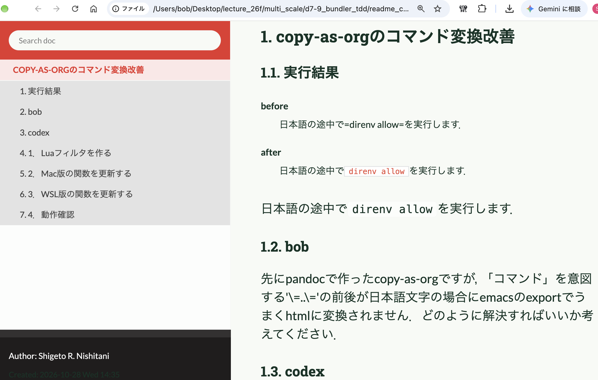

#+OPTIONS: ^:{}
#+STARTUP: indent nolineimages overview num
#+TITLE: d7-9 bundle, thor, minitest, gems
#+AUTHOR: Shigeto R. Nishitani
#+EMAIL:     (concat "shigeto_nishitani@mac.com")
#+LANGUAGE:  jp
#+OPTIONS:   H:4 toc:t num:2
#+SETUPFILE: https://fniessen.github.io/org-html-themes/org/setup/html-theme-readtheorg.setup
#+HTML_HEAD: <link rel="stylesheet" type="text/css" href=".style_w_link_button.css" />
#+MACRO: dummy_link @@html:<a href="#">$1</a>@@

# for style.css, never move from here
[[file:d9_gem_release/readme.html][prev_button]]
[[file:./canvas.html][up_button]]
[[file:./readme_agent_compare.html][next_button]]
# for a real link rewrite usual [[\url][]]

# | 

* d7 HyperCardって何？
- [[https://ist.ksc.kwansei.ac.jp/~nishitani/Research/2026/phase_diagram_26f/canvas.html][合金状態図26f]]
- [[file:../c0_mk_stack_dir/c4_hc_vs_others/readme_hc_vs_wiki.org][HyperCard vs others]]
- Markup言語
  - markdown on code, jupyter notebook(.md), 
  - org-mode on emacs (.org)
  - handoc (latex, docs, )

* d8 bundle, minitest, Thor ~= Rakefile
* d9 gemの完成，
- claの置き場所 :: 
  - ./cla, 
  - ~/bin/cla, 
  - Rakefile, claの格納庫
  - /usr/local/bin/cla, 
- RubyGems
  - gem release
- docs

