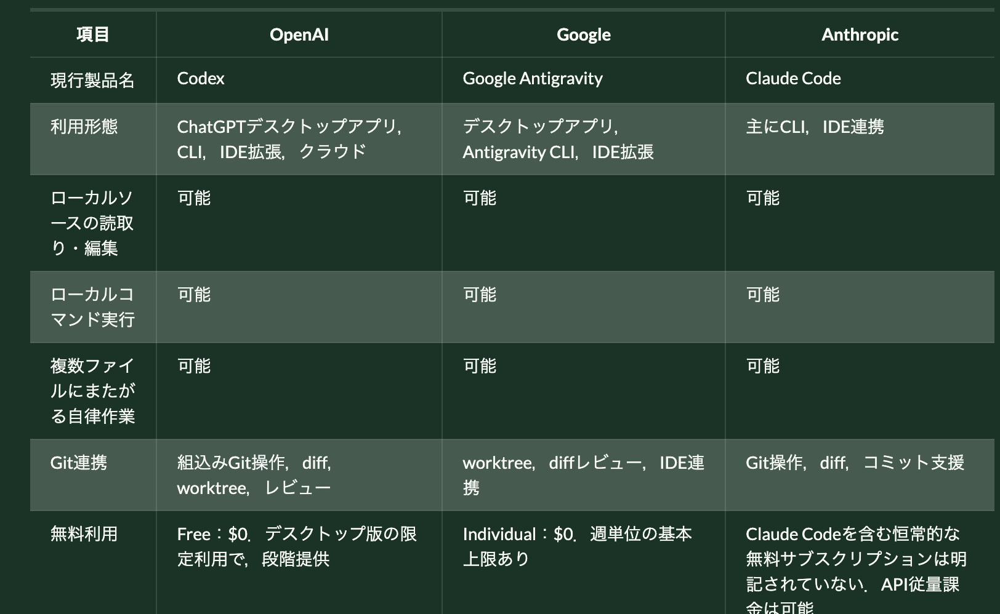

#+OPTIONS: ^:{}
#+STARTUP: indent nolineimages overview num
#+TITLE: Agent application comparison
#+AUTHOR: Shigeto R. Nishitani
#+EMAIL:     (concat "shigeto_nishitani@mac.com")
#+LANGUAGE:  jp
#+OPTIONS:   H:4 toc:t num:2
#+SETUPFILE: https://fniessen.github.io/org-html-themes/org/setup/html-theme-readtheorg.setup
#+HTML_HEAD: <link rel="stylesheet" type="text/css" href=".style_w_link_button.css" />
#+MACRO: dummy_link @@html:<a href="#">$1</a>@@

# for style.css, never move from here
[[file:./readme.html][prev_button]]
[[file:./canvas.html][up_button]]
[[file:./readme_mk_canvas_rake.html][next_button]]
# for a real link rewrite usual [[\url][]]

| 

* turn 1 web or desktop appli for chatgpt
** user
学生がweb版のChatGPTをbasicライセンスで使っています．これはcodexのようにlocal pcのsource dirsを参照してagenticに動かすことは可能ですか？　乗り換えた場合は，何を設定する必要がありますか？
** reply
結論として，*通常のWebブラウザ版ChatGPTだけでは，学生PC上のソースディレクトリを直接参照・編集したり，ローカルコマンドを実行したりすることはできません*．Web版のChatGPT
Projectも，ローカルフォルダへ直接アクセスするものではなく，ファイルのアップロードや外部ソース接続が基本です．

Codexのようにローカルでagenticに動かすには，学生PCに次のいずれかが必要です．

- ChatGPTデスクトップアプリのCodex機能
- Codex CLI
- VS Code等のCodex IDE拡張

これらは，指定したフォルダを読み，ファイルを編集し，テストやビルドなどのコマンドを実行できます．[[https://learn.chatgpt.com/docs/projects?surface=app][OpenAI Docs：Projects and chats]]

*** 「Basicライセンス」について
:PROPERTIES:
:CUSTOM_ID: basicライセンスについて
:END:
OpenAIの現在の公式プラン名には，少なくとも公開価格表上は「Basic」という名称がありません．学生が使っているものが次のどれかを確認する必要があります．

- ChatGPT Free
- ChatGPT Go
- ChatGPT Plus
- 大学が提供するChatGPT Edu／Enterprise
- 大学独自サービス上でChatGPTを利用できる「Basic」契約

現在の公式説明では，Codex自体はFree，Go，Plus，Pro，Business，Edu，Enterpriseに含まれます．ただし，利用できるクライアント，モデル，回数，管理者設定はプランによって異なります．Free／Goではデスクトップアプリ上の限定的な利用が段階提供され，PlusではWeb，CLI，IDE拡張などが明示的に提供されています．授業で全員に同じ環境を保証するなら，*Plus以上または大学管理のEdu契約*のほうが確実です．[[https://learn.chatgpt.com/docs/pricing][OpenAI Docs：Pricing]]

「Basic」が大学管理ワークスペースの契約名なら，大学の管理者に以下を確認してください．

- CodexまたはローカルCodexの利用が許可されているか
- 学生ロールにローカルクライアントへのサインイン権限があるか
- 利用可能なモデルと使用量制限
- ソースコードのデータ保持・学習利用ポリシー
- ローカルコンピュータアクセスが管理者によって無効化されていないか

*** 乗り換え時の設定
:PROPERTIES:
:CUSTOM_ID: 乗り換え時の設定
:END:
最も簡単なのはChatGPTデスクトップアプリです．

1. 学生PCにChatGPTデスクトップアプリをインストールする．
2. Web版と同じChatGPTアカウントでサインインする．
3. アプリ上でCodexを選択する．
4. プロジェクトを作成し，対象のソースフォルダを追加する．
5. 複数フォルダがある場合は，Git操作や設定探索の基準にするフォルダをPrimaryに指定する．
6. 権限モードは，授業ではまず「Ask for approval」を選ぶ．
7. Gitリポジトリを作成し，作業前の状態をコミットしておく．

CLIの場合は，対象ディレクトリでCodexを起動します．

#+begin_src sh
cd path/to/project
codex
#+end_src

初回起動時に「Sign in with
ChatGPT」を選びます．別のディレクトリから起動する場合は，次のようにも指定できます．

#+begin_src sh
codex --cd path/to/project
#+end_src

公式のCLI導入手順は[[https://learn.chatgpt.com/docs/cli][OpenAI Docs：Codex CLI]]にあります．

*** 授業用として推奨する初期設定
:PROPERTIES:
:CUSTOM_ID: 授業用として推奨する初期設定
:END:
プロジェクト直下に​=AGENTS.md=​を置くと，学生ごとの指示のばらつきを抑えられます．例えば次のような内容です．

#+begin_src md
# Course instructions

- 変更前に既存コードを確認すること
- 指定されたファイル以外を不必要に変更しないこと
- 変更後にテストを実行すること
- テストが失敗した場合は，失敗内容を報告すること
- パスワード，APIキー，個人情報をファイルへ書き込まないこと
- 使用したAI支援と主な変更点を提出物に記載すること
#+end_src

さらに，次を揃えておくと安全です．

- ​=.gitignore=​に​=.env=​，認証情報，生成物を登録する．
- 作業開始前にGitの初期コミットを作る．
- Python，Node.js，コンパイラ等のバージョンを統一する．
- ​=README.md=​にセットアップ，テスト，提出方法を書く．
- 最初はネットワークアクセスを承認制にする．
- Full accessは原則使用しない．

「Ask for
approval」では，Codexは通常，指定ワークスペース内を読み書きできますが，その外側へのアクセスやインターネット利用時に承認を求めます．授業用途ではこのモードが妥当です．[[https://learn.chatgpt.com/docs/permission-modes][OpenAI Docs：Permissions]]

なお，ChatGPT契約でCodexが使えない場合でもAPIキー認証は可能ですが，これはサブスクリプションとは別の従量課金です．学生個人にAPIキーを作らせる運用は，費用管理やキー流出の問題があるため，授業ではChatGPTサインイン方式または大学管理のEdu環境を推奨します．[[https://learn.chatgpt.com/docs/auth?surface=cli][OpenAI Docs：Authentication]]

* turn 2 codex, gemini, claude comparison
** user
Codex, Gemini, Claudeの同等の形態と，費用に関する一覧表を作成してください．
** codex reply
2026年11月5日時点の公式情報に基づく比較です．ここでは，製品を次の3層に分けています．

- 一般的なWebチャット：ChatGPT，Gemini，Claude
- ローカルPC上のソースを扱うエージェント：Codex，Google
  Antigravity，Claude Code
- 大学向け契約：ChatGPT Edu，Gemini for Education，Claude for Education

料金は米国向け税別価格です．日本での実際の請求額，消費税，為替，教育機関向け割引は契約画面または見積りで確認する必要があります．

*** ローカル開発エージェントの比較
:PROPERTIES:
:CUSTOM_ID: ローカル開発エージェントの比較
:END:
| 項目                           | OpenAI                                                           | Google                                                                                 | Anthropic                                                                            |
|--------------------------------+------------------------------------------------------------------+----------------------------------------------------------------------------------------+--------------------------------------------------------------------------------------|
| 現行製品名                     | Codex                                                            | Google Antigravity                                                                     | Claude Code                                                                          |
| 利用形態                       | ChatGPTデスクトップアプリ，CLI，IDE拡張，クラウド                | デスクトップアプリ，Antigravity CLI，IDE拡張                                           | 主にCLI，IDE連携                                                                     |
| ローカルソースの読取り・編集   | 可能                                                             | 可能                                                                                   | 可能                                                                                 |
| ローカルコマンド実行           | 可能                                                             | 可能                                                                                   | 可能                                                                                 |
| 複数ファイルにまたがる自律作業 | 可能                                                             | 可能                                                                                   | 可能                                                                                 |
| Git連携                        | 組込みGit操作，diff，worktree，レビュー                          | worktree，diffレビュー，IDE連携                                                        | Git操作，diff，コミット支援                                                          |
| 無料利用                       | Free：$0．デスクトップ版の限定利用で，段階提供                   | Individual：$0．週単位の基本上限あり                                                   | Claude Codeを含む恒常的な無料サブスクリプションは明記されていない．API従量課金は可能 |
| 標準的な個人向け料金           | Plus：$20／月                                                    | Google AI Pro：$20／月                                                                 | Pro：$20／月，または年払い実質$17／月                                                |
| 多用する個人向け               | Pro：$100，$200，$500／月                                        | Google AI Ultra：$100または$200／月                                                    | Max：$100または$200／月                                                              |
| 超過利用                       | ChatGPT creditsまたはAPIキーによる従量課金                       | AI creditsによる従量課金                                                               | Anthropic ConsoleのAPI従量課金                                                       |
| 学生の導入容易性               | デスクトップアプリが最も容易．PlusならCLI・IDEも明示的に利用可能 | 無料のAntigravityから試しやすい                                                        | Pro契約後にCLIを導入するのが基本                                                     |
| 授業での管理性                 | Eduでは管理者がCodex利用，権限，モデル等を制御可能               | 個人版と大学向けWorkspaceは別．大学向けGemini契約だけではAntigravity権利が保証されない | Education契約でClaude Codeまで含まれるかは個別契約の確認が必要                       |

料金と機能の根拠は，[[https://learn.chatgpt.com/docs/pricing?codex-pricing-plans=individual][OpenAI DocsのCodex料金]]，[[https://antigravity.google/pricing][Google Antigravity料金]]，[[https://www.anthropic.com/pricing?subjects=claude&type=product][Anthropic料金]]です．

なお，Googleでは，従来の個人向けGemini Code AssistとGemini
CLIのGoogleログインが2026年6月18日に終了しています．現在，Codexに直接対応するGoogle製品は，実質的にGoogle
Antigravityです．[[https://developers.google.com/gemini-code-assist/docs/deprecations/code-assist-individuals][Google公式：Gemini Code Assist個人版の廃止]]

*** 大学向け契約の比較
:PROPERTIES:
:CUSTOM_ID: 大学向け契約の比較
:END:
| 項目                       | ChatGPT Edu                                    | Gemini for Education                                                                            | Claude for Education                          |
|----------------------------+------------------------------------------------+-------------------------------------------------------------------------------------------------+-----------------------------------------------|
| 提供会社                   | OpenAI                                         | Google                                                                                          | Anthropic                                     |
| 対象                       | 学生，教職員，研究者，大学業務                 | 学生，教職員，大学業務                                                                          | 学生，教職員，大学業務                        |
| 基本Webチャット            | ChatGPT                                        | Gemini                                                                                          | Claude                                        |
| 大学向け基本料金           | 非公開，営業見積り                             | Gemini for Educationは適格機関なら$0                                                            | 非公開，営業見積り                            |
| 上位教育プラン             | Edu Plus，Edu Pro，いずれも見積り              | Google AI Pro for Education                                                                     | 個別見積り                                    |
| 上位教育プランの公開価格   | 非公開                                         | 年契約$20／人・月，月契約$24／人・月                                                            | 非公開                                        |
| 教育機関向け割引           | 個別契約                                       | Education Plus契約者が50～999ライセンスを年契約する場合，条件付きで$15／人・月                  | 「割引料金」と記載されているが金額非公開      |
| SSO・ユーザー管理          | あり                                           | Google Workspace管理コンソール                                                                  | あり                                          |
| データのモデル学習への使用 | 組織データはデフォルトで学習に使用されない     | 教育向けCore Serviceでは学習に使用されない                                                      | 組織向け契約条件に従う                        |
| ローカル開発エージェント   | CodexをEduワークスペースで管理可能             | Gemini for Education／AI Pro for EducationだけでAntigravityが付属するとは公式に明記されていない | Claude Codeの包含範囲は契約確認が必要         |
| プログラミング授業への適合 | 高い．Edu管理下でローカルCodexを学生に許可可能 | Web上の学習支援は導入しやすい．ローカルエージェントは別途Gemini Enterprise等の確認が必要        | Claude Codeを含む契約条件が得られれば利用可能 |
| 調達方法                   | OpenAI営業窓口                                 | Googleまたは販売パートナー                                                                      | Anthropic営業窓口                             |

教育プランの公式情報は以下です．

- [[https://learn.chatgpt.com/docs/enterprise/education-plans][OpenAI Docs：ChatGPT教育プラン]]
- [[https://edu.google.com/intl/ALL_us/ai/gemini-for-education/][Google：Gemini for Education]]
- [[https://www.anthropic.com/news/introducing-claude-for-education][Anthropic：Claude for Education]]

*** Googleの教育契約で注意する点
:PROPERTIES:
:CUSTOM_ID: googleの教育契約で注意する点
:END:
Googleは名称が似ていますが，次を分けて考える必要があります．

| Google製品                     | 主目的                                    | ローカルソースへのagenticアクセス               |
|--------------------------------+-------------------------------------------+-------------------------------------------------|
| Gemini for Education           | 教育向けWebチャット                       | 基本的にはなし                                  |
| Google AI Pro for Education    | Gemini，Notebook，Gmail，Docs等の上位機能 | Antigravity付属は公式ページ上で明記されていない |
| Google Antigravity個人版       | ローカル開発エージェント                  | あり                                            |
| Gemini Enterprise＋Antigravity | 組織管理された開発エージェント            | あり                                            |
| Gemini API                     | アプリや独自ツールへの組込み              | 実装次第                                        |

Googleの組織管理下でAntigravityを使う場合は，現時点では有料のGemini
Enterprise
Standard，Plus，または従量課金版が対象として明記されています．教育向けGemini
Enterprise
EDUは存在しますが，Antigravityの対象エディション一覧にはEduが明記されていません．したがって，大学向けGoogle契約を検討する場合は，​*「Geminiが使えるか」ではなく「学生にAntigravityのローカル開発機能を割り当てられるか」*​を販売窓口に確認する必要があります．[[https://docs.cloud.google.com/gemini/enterprise/docs/ai-developer-tools-overview][Google Cloud：AI developer tools]]

*** 授業での費用イメージ
:PROPERTIES:
:CUSTOM_ID: 授業での費用イメージ
:END:
学生100人が1学期利用する単純な月額換算例です．税，割引，超過料金は含みません．

| 構成                                | 1人あたり月額 | 100人・1か月 | 特記事項                                         |
|-------------------------------------+---------------+--------------+--------------------------------------------------|
| Codex Plus                          | $20           | $2,000       | CLI・IDE・デスクトップを利用可能                 |
| Antigravity Free                    | $0            | $0           | 上限があり，授業中の安定利用を保証しにくい       |
| Google AI Pro個人版                 | $20           | $2,000       | 個人Googleアカウント契約                         |
| Google AI Pro for Education・年契約 | $20           | $2,000       | Workspaceの教育向け上位機能．Antigravityは要確認 |
| Claude Pro                          | $20           | $2,000       | Claude Codeを含む                                |
| Codex／ChatGPT Edu                  | 見積り        | 見積り       | 大学管理，SSO，監査，権限制御                    |
| Claude for Education                | 見積り        | 見積り       | Claude Codeの包含条件も見積り時に確認            |

*** 関西学院大学での授業用途なら
:PROPERTIES:
:CUSTOM_ID: 関西学院大学での授業用途なら
:END:
目的が「学生PCのソースディレクトリを参照し，コード編集，テスト，実行まで行わせること」であれば，比較対象は次の3製品です．

1. Codex PlusまたはChatGPT Edu＋Codex
2. Google Antigravity
3. Claude Pro＋Claude Code，またはClaude for Education＋Claude Code権利

全学管理，SSO，データ保護，学生アカウントの一括発行まで必要なら，公開価格だけで選ぶことはできません．OpenAIとAnthropicには大学向け見積りを依頼し，Googleには「Gemini
for
Education」ではなく「Antigravityを学生に提供できる契約」を指定して問い合わせる必要があります．

少人数の試行授業であれば，費用と導入容易性のバランスからは，​*Codex
Plus，Google Antigravity Free／Pro，Claude
Proを各数名で比較する*​のが現実的です．本格導入では，管理機能が明確で，EduワークスペースからローカルCodexの権限を制御できるChatGPT
Eduが比較しやすい構成です．

