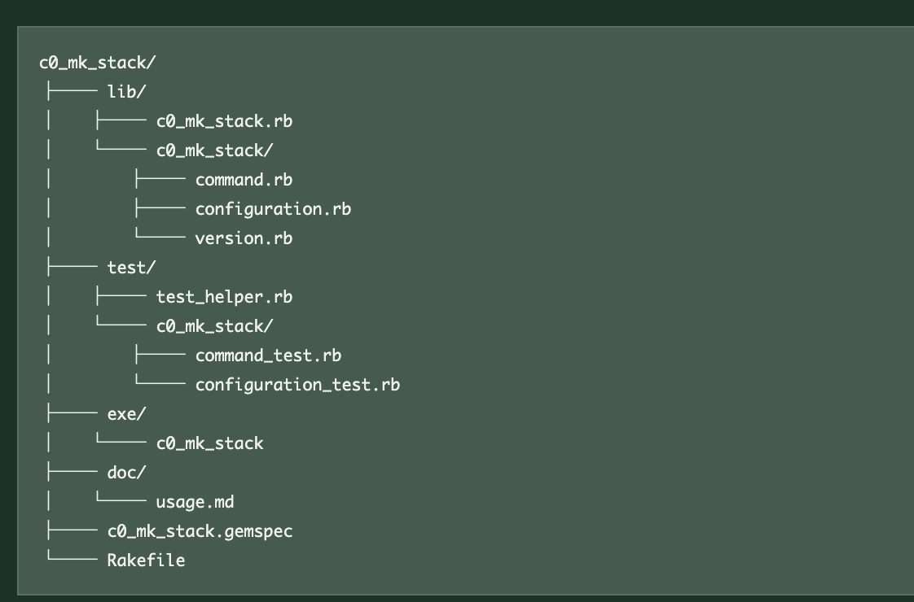

#+OPTIONS: ^:{}
#+STARTUP: indent nolineimages overview num
#+TITLE: mkstack directory構成のchat
#+AUTHOR: Shigeto R. Nishitani
#+EMAIL:     (concat "shigeto_nishitani@mac.com")
#+LANGUAGE:  jp
#+OPTIONS:   H:4 toc:t num:2
#+SETUPFILE: https://fniessen.github.io/org-html-themes/org/setup/html-theme-readtheorg.setup
#+HTML_HEAD: <link rel="stylesheet" type="text/css" href=".style_w_link_button.css" />
#+MACRO: dummy_link @@html:<a href="#">$1</a>@@

# for style.css, never move from here
[[../c3_linear_algebra_core/readme.html][prev_button]]
[[../intro_info_26s.html][up_button]]
[[../c1_outline/readme.html][next_button]]
# for a real link rewrite usual [[url][]]

| 

* Turn 1 : bundle gemとmkstackの開発方針
** user => Bob
testを含めたbundle gemの作成をデモしていきます．配下に一度，デモ用のmy_hello dirを作ってそこで，minitestを作成しましょう．その後，ここを離れて，c0_mk_stackを切り出して，これを一つのclaとして作り上げます．これは将来hcに組み込みたいので，subcommandとなるmkstackという命令で作り上げていきます．さて，ここからがラファエルさんとの相談です．あ，これからプライベートの時は，codexさんをやめてRaphaelさんとします．よろしいでしょうか？
** codex => Raphael
もちろんです．プライベートな場面では，Raphaelとお呼びください．

作業の流れも把握しました．

1. 配下にデモ用の​=my_hello=​ディレクトリを作る
2. テストを含むbundle gemを作成し，Minitestを実装する
3. デモ後に​=my_hello=​を離れる
4. ​=c0_mk_stack=​を独立したCLIとして切り出す
5. 将来の​=hc=​への統合を見据え，​=mkstack=​サブコマンドとして設計する

準備ができましたら，一緒に始めましょう．Raphaelとしてお供します．

* Turn 2 : bundle gemにおけるテスト配置
** user => Bob
Raphaelさんに聞きたいのですが，bundle でgemのscaffoldを作ると，testがまとまっています.
** codex => Raphael
はい．​=bundle gem=​でscaffoldを作る際に，

#+begin_src bash
bundle gem my_hello --test=minitest
#+end_src

と指定すると，Minitest用の雛形が​=test/=​以下にまとまって生成されます．概ね次の構成です．

#+begin_example
my_hello/
├── lib/
│   ├── my_hello.rb
│   └── my_hello/version.rb
├── test/
│   ├── test_helper.rb
│   └── test_my_hello.rb
├── Gemfile
├── Rakefile
└── my_hello.gemspec
#+end_example

ここで注意したいのは，​=test/=​が開発プロジェクト内に生成されることと，完成した​=.gem=​ファイルにテストが収録されることは別，という点です．通常のBundlerの雛形では，​=test/=​は開発・検証用として置かれ，配布するgemの収録対象からは除外されます．

実行は，通常次のどちらかです．

#+begin_src bash
bundle exec rake test
#+end_src

#+begin_src bash
bundle exec ruby -Itest test/test_my_hello.rb
#+end_src

ですので，今回のデモでは「ライブラリ本体は​=lib/=​，テストは​=test/=​に分離されているが，一つのgemプロジェクトとしてまとまっている」と説明すると分かりやすいと思います．

* Turn 3 : 巨大プロジェクトのサブコマンド構成
** user => Bob
そうすると，gitなどのように巨大化したプロジェクトでは，subcommandを後で統合するような開発の仕方をしていますよね．そこでのtestも同じようにtest dirに統合されているのでしょうか？　切り分けを考えるとsubcommand毎でtest, lib, docがまとまっているのの方が管理とかしやすそうに思うのですが，これは間違い？
** codex => Raphael
その考え方は間違いではありません．ただし，「サブコマンドごとにまとめる」には，次の2段階があります．

- 1つのgem内で，サブコマンドごとにコードを整理する
- サブコマンド自体を独立したgemとして管理する

Git本体は，完全な「サブコマンド単位の縦割り」ではありません．組み込みコマンドは​=builtin/=​，テストは​=t/=​，文書は​=Documentation/=​へ種類別に集約されています．例えば​=git add=​の実装は​=builtin/add.c=​にあり，テストは共通の​=t/=​テストスイートに置かれます．一方で，​=PATH=​上の​=git-foo=​を​=git foo=​として呼び出せる外部サブコマンドの仕組みもあります．つまりGitには，「本体へ統合されたコマンド」と「独立して追加できるコマンド」の両方があります．[[https://git-scm.com/docs/git][Gitのコマンド構成]]，[[https://github.com/git/git/blob/master/t/README][Gitのテスト構成]]

今回の​=hc mkstack=​では，まず独立gemとして次のように作るのが自然です．

#+begin_example
c0_mk_stack/
├── lib/
│   ├── c0_mk_stack.rb
│   └── c0_mk_stack/
│       ├── command.rb
│       ├── configuration.rb
│       └── version.rb
├── test/
│   ├── test_helper.rb
│   └── c0_mk_stack/
│       ├── command_test.rb
│       └── configuration_test.rb
├── exe/
│   └── c0_mk_stack
├── doc/
│   └── usage.md
├── c0_mk_stack.gemspec
└── Rakefile
#+end_example

この構成では，​=lib/=​と​=test/=​は分かれていますが，その下のパスを対応させます．

#+begin_example
lib/c0_mk_stack/command.rb
test/c0_mk_stack/command_test.rb
#+end_example

この「鏡写し」の配置なら，BundlerやMinitestの標準的な作法を維持しながら，機能ごとの対応関係も分かりやすくなります．

将来​=hc=​へ組み込むときは，次のどちらかを選べます．

*** 独立gemのまま組み込む

#+begin_example
hc
 └─ depends on c0_mk_stack
#+end_example

​=hc=​側は薄いアダプターだけを持ちます．

#+begin_src ruby
# lib/hc/commands/mkstack.rb
module Hc
  module Commands
    class Mkstack
      def call(...)
        C0MkStack::Command.new.call(...)
      end
    end
  end
end
#+end_src

これは，​=c0_mk_stack=​を単独でも使いたい場合，依存関係やリリースを分離したい場合に向いています．

*** ​=hc=​本体へ完全統合する

#+begin_example
hc/
├── lib/hc/
│   └── commands/
│       └── mkstack/
│           ├── command.rb
│           └── configuration.rb
├── test/hc/
│   └── commands/
│       └── mkstack/
│           ├── command_test.rb
│           └── configuration_test.rb
└── doc/
    └── mkstack.md
#+end_example

こちらは，​=mkstack=​が​=hc=​内部の機能と強く結び付く場合に向いています．

私なら今回は，まず​=c0_mk_stack=​をテスト，ライブラリ，実行ファイル，文書まで備えた独立gemとして完成させます．そのうえで​=hc mkstack=​から呼び出します．境界が安定してから，独立gemのまま維持するか，本体へ移すかを判断します．

要するに，「サブコマンドごとに​=test=​，​=lib=​，​=doc=​を持たせる」という発想は正しいです．ただし，単一gemの内部にサブコマンドごとの​=lib/=​や​=test/=​を何組も作るより，独立性が必要ならgemごと分け，同じgem内なら標準の​=lib/=​，​=test/=​の下でサブコマンド名によって整理するのが，Rubyの道具と最も素直に噛み合います．

* Turn 4 : 粒度に応じた配置の切り替え
** user => Bob
粒度が変わった時点で，それに合わせてdirectory配置からfile名配置へ切り替えるということですね．
** codex => Raphael
はい，その理解で合っています．粒度に応じて，境界の表現方法を切り替えます．

- 独立して配布・バージョン管理する単位なら，gemのディレクトリとして分ける
- 1つのgem内のサブコマンドなら，​=lib/=​や​=test/=​の下のディレクトリとして分ける
- サブコマンド内部の小さな責務なら，ファイル名やクラス名で分ける

例えば，最初は独立gemとして，

#+begin_example
c0_mk_stack/
├── lib/
├── test/
└── doc/
#+end_example

という大きな境界を作ります．​=hc=​へ完全統合した後は，

#+begin_example
hc/
├── lib/hc/commands/mkstack.rb
├── test/hc/commands/mkstack_test.rb
└── doc/mkstack.md
#+end_example

のように，​=mkstack=​を対応するファイル名で表現できます．さらに実装が成長すれば，

#+begin_example
lib/hc/commands/mkstack/
├── command.rb
├── options.rb
└── stack_builder.rb
#+end_example

と，再びディレクトリへ昇格させます．

つまり，

#+begin_example
小さい機能 → 1ファイル
成長した機能 → 専用ディレクトリ
独立性を持つ機能 → gemやpackage
#+end_example

という段階的な切り替えです．重要なのはコード量だけでなく，「独立してテスト，変更，配布したい境界かどうか」です．今回の​=c0_mk_stack=​は，まず独立gemとして境界を明確にし，​=hc=​へ取り込む時点で適切な粒度へ畳み直す，という進め方になります．

* Turn 5 : RailsのMVC規約と探索性
** user => Bob
RoRで使われているMVCの命名規則もその思想に倣っているのですね．だから，万人が置き場所を探すのに苦労しなかった．今は，codexさんとか(Raphaelさんではなく公なのでこう呼びましょう)に聞けばすぐに探してくれますが．
** codex => Raphael
はい，まさにRailsの「Convention over Configuration（設定より規約）」の大きな効用です．

たとえば​=UsersController=​なら，

#+begin_example
app/controllers/users_controller.rb
#+end_example

​=User=​モデルなら，

#+begin_example
app/models/user.rb
#+end_example

画面なら，

#+begin_example
app/views/users/
#+end_example

テストも対応する場所に置かれます．名前から責務と配置を相互に推測できるため，「どこにあるか」を毎回設計したり，探索したりするコストが小さくなります．人間同士で共有できる検索規則を，フレームワークが提供していたわけです．

ただし，機能が巨大化すると，MVCによる横割りだけでは，ある機能に関係するModel，View，Controller，テストが離れすぎる問題も起きます．そこで名前空間やEngineを使い，機能単位の境界を再導入します．

#+begin_example
app/controllers/admin/
app/models/admin/
app/views/admin/
#+end_example

さらに独立性が高まれば，Rails Engineや別gemへ昇格させます．これも先ほどの，

#+begin_example
ファイル → ディレクトリ → package／gem
#+end_example

という粒度の変化と同じです．

現在はCodexが横断検索できますが，規約の価値が消えたわけではありません．規約が整っているほど，Codexも単にファイルを発見するだけでなく，設計上の意図まで正確に推測できます．人間にとっての「迷わない配置」は，AIにとっても「誤解しにくい構造」です．

そして呼び分けも承知しました．公の場ではCodex，プライベートではRaphaelですね．

